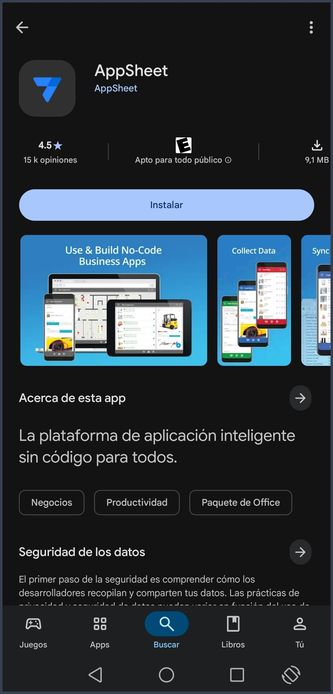
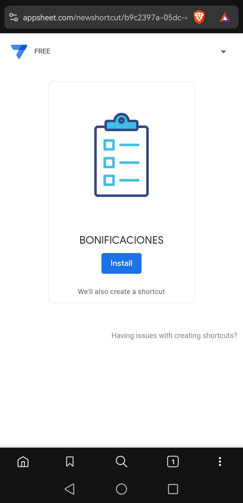
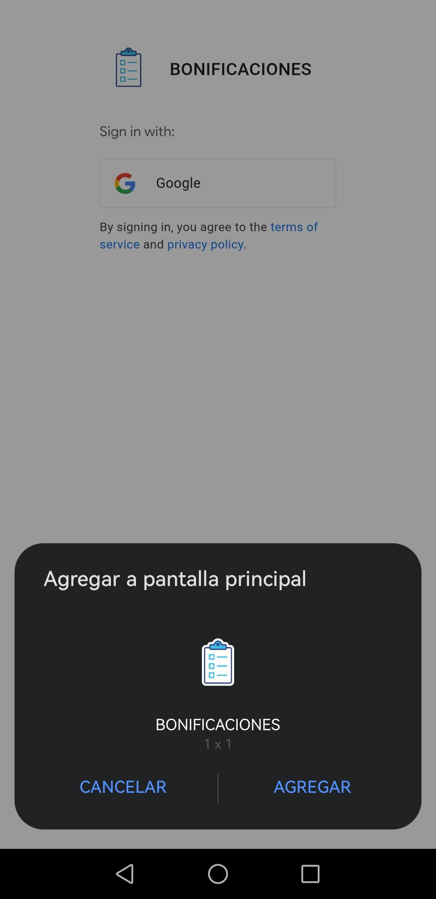
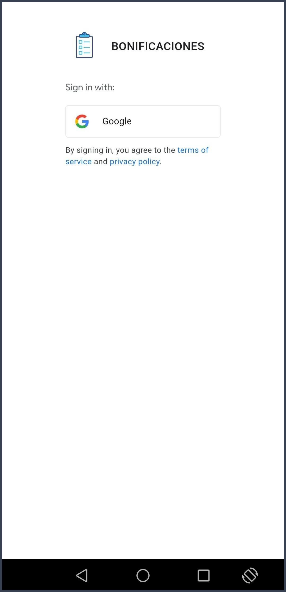
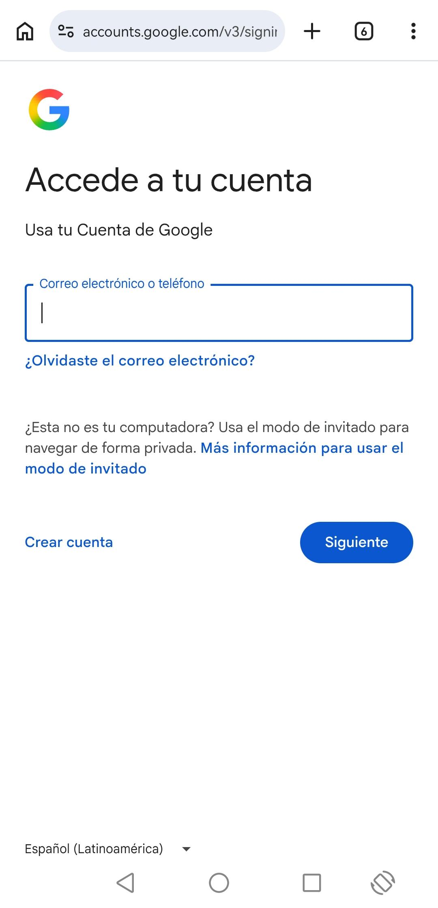
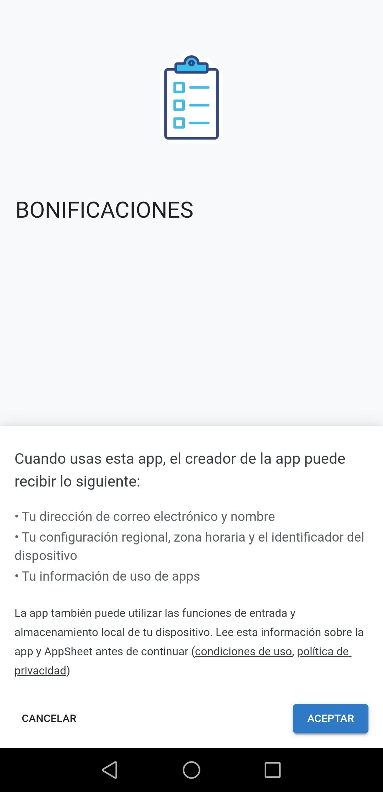

# Guía Rápida: Instalación de la App Bonificaciones

**Proyecto:** Sistema Control de Bonificaciones en Bodega  
**Empresa:** Intereléctricos Group SAS  
**Destinatarios:** Personal Operativo de Bodega, Supervisores y Despachadores  

---

Sigue estos **4 sencillos pasos** para tener la aplicación lista en tu teléfono celular:

---

### PASO 1: Descarga AppSheet

1. Entra a la tienda de aplicaciones de tu celular (**Play Store** en Android o **App Store** en iPhone).
2. Busca la aplicación gratuita **AppSheet** e instálala.  
   *(Solo instálala, **no** es necesario abrirla todavía).*

  

---

### PASO 2: Abre el enlace e instala

1. Toca el enlace oficial de instalación para celulares:  
   **[https://www.appsheet.com/newshortcut/b9c2397a-05dc-4cb0-8a6d-d5938c6aadc5](https://www.appsheet.com/newshortcut/b9c2397a-05dc-4cb0-8a6d-d5938c6aadc5)**  
   *(Enlace de acceso directo exclusivo para dispositivos móviles).*
2. Se abrirá una pantalla con el logo de la aplicación.
3. Toca el botón azul **Install**.

  

---

### PASO 3: Agrega a pantalla principal y acceso a la app

1. **Agregar a pantalla principal:** Te aparecerá un aviso emergente en pantalla; toca la opción **Agregar a pantalla principal** (o **Agregar** según la marca de tu teléfono).

  

2. **Acceso al aplicativo (según la configuración vigente):**
   * **Ingreso directo (Configuración actual):** Si el aplicativo no te solicita cuenta, ingresará de forma automática. En ese caso, avanza directamente al **PASO 4**.
   * **Si el sistema solicita inicio de sesión:** En caso de que se active el control de usuarios y te muestre la pantalla de Google:
     * Toca el botón **Sign in with Google**.

  

     * Selecciona tu cuenta de correo autorizada (o pulsa *"Usar otra cuenta"* si no figura en pantalla). Si es tu primera vez, acepta los permisos de acceso.
     * **Nota importante de soporte:** Si al ingresar tu correo la aplicación no te permite el acceso o indica falta de permisos, comunícate con el **departamento de sistemas** para que agreguen tu dirección de correo a la lista de usuarios autorizados.

  

---

### PASO 4: Confirmación y uso

1. Verás una pantalla de bienvenida con el logo, el título de la aplicación y un botón central.
2. Toca el botón **OK**.
3. **¡Listo!** Ya estás dentro del aplicativo de Bonificaciones. A partir de ahora podrás ingresar directamente tocando el ícono creado en la pantalla de tu celular.

  

