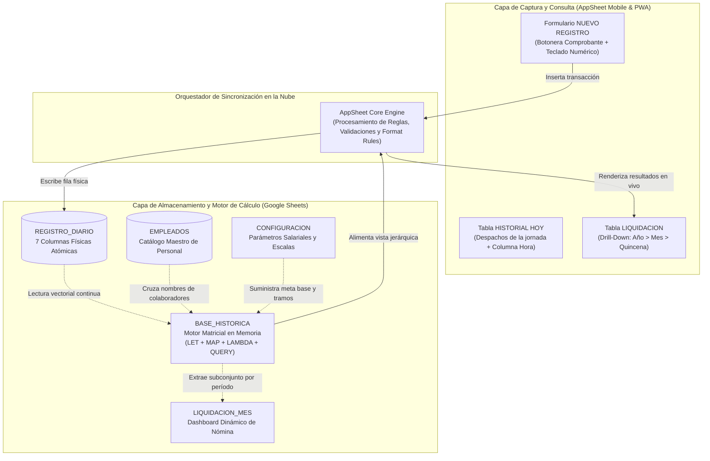

# Informe Técnico y Manual de Configuración de Arquitectura

**Proyecto:** SISTEMA DE LIQUIDACIÓN Y AUDITORÍA DE BONIFICACIONES EN BODEGA  
**Empresa:** INTERELÉCTRICOS GROUP SAS  
**Fecha:** Octubre de 2026 | Versión 2.0 (Arquitectura Matricial en Memoria y Centralización Histórica)  
**Autor:** Mauricio Sierra – Aprendiz ADSO SENA  
**Entorno Tecnológico:** Arquitectura Híbrida en la Nube (AppSheet Engine + Google Sheets Advanced Matrix Engine)

---

## Tabla de Contenidos

1. [Alcance, Objetivos y Justificación de la Evolución](#1-alcance-objetivos-y-justificación-de-la-evolución)
2. [Arquitectura General y Flujo de Información](#2-arquitectura-general-y-flujo-de-información)
3. [Diccionario y Modelo de Base de Datos (Backend en Google Sheets)](#3-diccionario-y-modelo-de-base-de-datos-backend-en-google-sheets)
   - 3.1. [Hoja EMPLEADOS (Catálogo Maestro)](#31-hoja-empleados-catálogo-maestro)
   - 3.2. [Hoja REGISTRO_DIARIO (Almacenamiento Transaccional Atómico)](#32-hoja-registro_diario-almacenamiento-transaccional-atómico)
   - 3.3. [Hoja BASE_HISTORICA (Motor de Consolidación Matricial)](#33-hoja-base_historica-motor-de-consolidación-matricial)
   - 3.4. [Hoja LIQUIDACION_MES (Dashboard Ejecutivo de Nómina)](#34-hoja-liquidacion_mes-dashboard-ejecutivo-de-nómina)
   - 3.5. [Hoja CONFIGURACION (Parámetros Financieros Globales)](#35-hoja-configuracion-parámetros-financieros-globales)
   - 3.6. [Justificación del Retiro de Tablas Satélites de la V1.0](#36-justificación-del-retiro-de-tablas-satélites-de-la-v10)
4. [Motor Matemático y Fórmulas Avanzadas (Análisis Algorítmico Exhaustivo)](#4-motor-matemático-y-fórmulas-avanzadas-análisis-algorítmico-exhaustivo)
   - 4.1. [El Generador Matricial Dinámico (`BASE_HISTORICA!A1`)](#41-el-generador-matricial-dinámico-base_historicaa1)
   - 4.2. [Proyección Funcional y Columnas de Liquidación (`G1:J1`)](#42-proyección-funcional-y-columnas-de-liquidación-g1j1)
   - 4.3. [Motor de Extracción Dinámica del Dashboard (`LIQUIDACION_MES!A5`)](#43-motor-de-extracción-dinámica-del-dashboard-liquidacion_mesa5)
5. [Marco Legal, Laboral y Calibración Salarial (Ley 1393 de 2010 / UGPP)](#5-marco-legal-laboral-y-calibración-salarial-ley-1393-de-2010--ugpp)
   - 5.1. [El Principio de la Regla del 40%](#51-el-principio-de-la-regla-del-40)
   - 5.2. [Calibración de la Meta Base y Tramos de Esfuerzo](#52-calibración-de-la-meta-base-y-tramos-de-esfuerzo)
   - 5.3. [Protocolo Financiero ante Facturas de Remisión (`IR`)](#53-protocolo-financiero-ante-facturas-de-remisión-ir)
6. [Capa de Interfaz Móvil y Motor de Aplicación (Frontend en AppSheet)](#6-capa-de-interfaz-móvil-y-motor-de-aplicación-frontend-en-appsheet)
   - 6.1. [Vistas Principales y Ergonomía en Pantalla](#61-vistas-principales-y-ergonomía-en-pantalla)
   - 6.2. [Columnas Virtuales y Resaltado Visual](#62-columnas-virtuales-y-resaltado-visual)
   - 6.3. [Políticas de Seguridad y Auditoría (15 Minutos)](#63-políticas-de-seguridad-y-auditoría-15-minutos)
7. [Matriz Comparativa de Trazabilidad: Versión 1.0 vs. Versión 2.0](#7-matriz-comparativa-de-trazabilidad-versión-10-vs-versión-20)

---

## 1. Alcance, Objetivos y Justificación de la Evolución

El sistema **BONIFICACIONES** fue concebido para resolver un problema operativo crítico en la bodega principal de Intereléctricos Group SAS: la medición y compensación del rendimiento del personal auxiliar de alistamiento y despacho. Históricamente, el control se realizaba de manera rudimentaria mediante conteo por rayas sobre un tablero acrílico en bodega. Este método presentaba severas falencias:
* Imposibilidad de auditar la complejidad real de los pedidos (un pedido de 1 fusible contaba igual que un pedido con corte de 300 metros de cable pesado).
* Pérdida de trazabilidad ante reclamos por inconsistencias o errores en mostrador.
* Alta fricción administrativa al liquidar manualmente planillas al cierre de quincena.

La **Versión 1.0** digitalizó la captura en AppSheet y estructuró hojas de cálculo con resúmenes basados en celdas de control temporal (`FILTRO_FECHAS`). Aunque operativa, la V1.0 reveló limitaciones estructurales: dependía de que un usuario modificara manualmente una celda con un calendario para recalcular las fórmulas matriciales `SUMAR.SI.CONJUNTO`, generaba lentitud en la sincronización móvil por consultas circulares en columnas virtuales, y forzaba al operario a digitar códigos alfanuméricos completos (`IR-12345`) en teclados móviles pequeños.

La **Versión 2.0** constituye un salto cualitativo hacia una **arquitectura desacoplada, reactiva y de alto rendimiento**, orientada bajo tres directrices:
1. **Ergonomía Operativa Táctica:** Reducción del tiempo de captura mediante la separación del tipo de comprobante en botoneras táctiles y el número en campo numérico puro (activando el teclado numérico de dígitos grandes en el celular).
2. **Motor de Datos en Memoria (Zero Redundancia):** Eliminación de tablas satélites y columnas calculadas estáticas. Creación de una matriz histórica consolidada al vuelo mediante funciones de programación funcional en Google Sheets (`LET`, `MAP`, `LAMBDA`, `QUERY`).
3. **Blindaje Jurídico y Financiero:** Calibración milimétrica de las escalas de incentivos respecto al Salario Mínimo Legal Vigente en Colombia y la Ley 1393 de 2010 (Regla del 40% de la UGPP).

---

## 2. Arquitectura General y Flujo de Información

La solución se estructura en dos capas principales conectadas mediante servicios en la nube:



1. **Frontend (AppSheet):** Ejecutado en dispositivos móviles Android/iOS de bodega y en terminales web de mostrador. Provee una interfaz táctil instantánea, validaciones de integridad en cliente y renderizado progresivo de datos.
2. **Backend (Google Sheets):** Actúa como base de datos relacional y motor de cálculo de alta velocidad. Implementa un modelo de datos normalizado donde las transacciones no se mezclan con cálculos auxiliares.

---

## 3. Diccionario y Modelo de Base de Datos (Backend en Google Sheets)

El libro corporativo `BD_BONIFICACIONES_BODEGA` cuenta con una estructura optimizada en cinco hojas de trabajo:

```
BD_BONIFICACIONES_BODEGA.xlsx
├── EMPLEADOS           [Catálogo Maestro de Colaboradores]
├── REGISTRO_DIARIO     [Transaccional Atómico — 7 Columnas Físicas]
├── BASE_HISTORICA      [Matriz Consolidada Dinámica — Motor Matricial]
├── LIQUIDACION_MES     [Dashboard Ejecutivo de Consulta y Nómina]
└── CONFIGURACION       [Parámetros Salariales, Meta Base y Escalas]
```

---

### 3.1. Hoja: `EMPLEADOS` (Catálogo Maestro)
* **Permiso en AppSheet:** `Read_Only`.
* **Propósito:** Registro canónico del personal de bodega.
* **Estructura de Columnas:**

| Columna | Nombre | Tipo de Dato | Rol / Restricción | Descripción |
| :---: | :--- | :---: | :---: | :--- |
| **A** | `ID_Empleado` | `Text` | Clave Primaria (`KEY`) | Número de cédula o identificador interno único del auxiliar (ej. `1002`). |
| **B** | `Nombre_Completo` | `Text` | Etiqueta (`LABEL`) | Nombre y apellidos completos del colaborador. |
| **C** | `Activo` | `Yes/No` | Control Booleano | `VERDADERO` (`TRUE`) o `FALSO` (`FALSE`). Determina si el empleado puede despachar. |

* **Columna Virtual en AppSheet:**
  * `Activo?`: Tipo `Text`, fórmula `IF([Activo], "SI", "NO")`. Permite consultar el estado sin exponer el valor crudo booleano.

---

### 3.2. Hoja: `REGISTRO_DIARIO` (Almacenamiento Transaccional Atómico)
* **Permiso en AppSheet:** `Updates, Adds` (Eliminación bloqueada).
* **Propósito:** Almacén permanente e inalterable de cada comprobante auditado. Se diseñó bajo un principio estricto de **atomicidad**, descartando columnas calculadas redundantes (como "Mes" o "Quincena" en texto) que inflarían el archivo con decenas de miles de cadenas idénticas.
* **Estructura de Columnas Físicas (7 columnas):**

| Columna | Nombre | Tipo de Dato | Modo de Captura | Rol / Comportamiento |
| :---: | :--- | :---: | :---: | :--- |
| **A** | `ID_Registro` | `Text` | Automático | Clave primaria (`KEY`), generada al vuelo con `UNIQUEID()`. |
| **B** | `Fecha_Hora` | `DateTime` | Automático | Marca de tiempo precisa generada con `NOW()`. Define la jornada y la ventana de edición. |
| **C** | `Empleado` | `Ref` | Lista desplegable | Apunta a `EMPLEADOS[ID_Empleado]`. Validado con `SELECT(EMPLEADOS[ID_Empleado], [Activo] = TRUE)`. |
| **D** | `Numero_Factura` | `Number` | Teclado numérico | Consecutivo numérico puro impreso en el comprobante físico (ej. `36278`). |
| **E** | `Puntos_Esfuerzo` | `Enum` (Number) | Botones `[1..5]` | Calificación operativa del pedido según su complejidad documental y física. |
| **F** | `Puntos_Error` | `Enum` (Number) | Botones `[0..-3]` | Penalizaciones por fallas en entrega (`0, -1, -2, -3`). Valor por defecto: `0`. |
| **G** | `Tipo_Factura` | `Enum` (Text) | Botones `[IC, DP, IR]` | Serie o tipo de documento físico auditado (`IC` = Factura, `DP` = Despacho, `IR` = Remisión). |

* **Columnas Virtuales de Exposición en AppSheet:**
  * `Factura` (`Text`): Fórmula `[Tipo_Factura] & "-" & [Numero_Factura]`. Es el **`LABEL` oficial** de la tabla, resolviendo la ambigüedad entre facturas que compartan el mismo consecutivo pero diferente serie (ej. `IC-100` vs `IR-100`).
  * `Hora` (`Text`): Fórmula `TEXT([Fecha_Hora], "H:MM AM/PM")`. Expone la hora en formato legible de 12 horas para encabezar la tabla de `HISTORIAL HOY`.

---

### 3.3. Hoja: `BASE_HISTORICA` (Motor de Consolidación Matricial)
* **Permiso en AppSheet:** `Read_Only`.
* **Propósito:** Es el corazón analítico del sistema. En lugar de ejecutar sumas y filtros manuales fila por fila, esta hoja contiene una **única fórmula matricial en la celda `A1`** que lee toda la tabla de `REGISTRO_DIARIO`, agrupa las marcas de tiempo en Quincenas y Meses en memoria de cálculo, totaliza puntos y errores, y proyecta las bonificaciones económicas en columnas adyacentes (`G1:J1`).
* **Estructura de Columnas (10 columnas):**

| Col. | Campo | Origen Técnico | Tipo | Descripción |
| :---: | :--- | :--- | :---: | :--- |
| **A** | `Año` | Generado por `QUERY(Col1)` | `Number` | Año calendario de los despachos (ej. `2026`). |
| **B** | `Mes` | Generado por `QUERY(Col2)` | `Number` | Mes numérico exacto (1..12). Mantenido oculto en AppSheet. |
| **C** | `Quincena` | Generado por `QUERY(Col3)` | `Text` | Código de quincena comercial calculado en memoria (`Q1` o `Q2`). |
| **D** | `ID_Empleado` | Generado por `QUERY(Col4)` | `Number` | Identificador del colaborador en el ciclo quincenal. |
| **E** | `Pts_Esfuerzo` | Generado por `SUM(Col6)` | `Number` | Sumatoria total de puntos de esfuerzo acumulados en la quincena. |
| **F** | `Pts_Error` | Generado por `SUM(Col7)` | `Number` | Sumatoria total de penalizaciones por error registradas en la quincena. |
| **G** | `Nombre` | Fórmula matricial `MAP` | `Text` | Nombre oficial obtenido mediante búsqueda vectorial cruzada sobre `EMPLEADOS`. |
| **H** | `Bono Productivo`| Fórmula matricial `MAP` | `Price` | Retribución económica devengada según escala quincenal ($ COP). |
| **I** | `Bono Calidad` | Fórmula matricial `MAP` | `Price` | Retribución por exactitud y cuidado, con piso de protección ($ COP). |
| **J** | `Total BONO` | Fórmula matricial `MAP` | `Price` | Compensación económica consolidada neta (`Productividad + Calidad`). |

* **Columnas Virtuales de Exposición en AppSheet:**
  * `ID_Liquidacion` (`Text`): Clave primaria compuesta generada mediante:
    ```appsheet
    CONCATENATE([Año], "-", [Mes], "-", [Quincena], "-", [ID_Empleado])
    ```
  * `Mes_Nombre` (`Text`): Nombre textual del mes para navegación amigable (`SWITCH([Mes], 1, "Enero", ..., 10, "Octubre", ...)`).
  * `Quincena_Nombre` (`Text`): Encabezado jerárquico (`IF([Quincena]="Q1", "1ra Quincena", "2da Quincena") & " · " & [Mes_Nombre] & " " & [Año]`).

---

### 3.4. Hoja: `LIQUIDACION_MES` (Dashboard Ejecutivo de Nómina)
* **Permiso en AppSheet:** No se conecta a AppSheet (se consume directamente en Google Sheets por Gerencia y Contabilidad).
* **Propósito:** Interfaz ejecutiva interactiva dentro del libro de cálculo que permite auditar y exportar nóminas de cualquier quincena o mes histórico con selectores desplegables dinámicos.
* **Barra de Parámetros Superiores:**
  * Celda `A2` (**Año**): Menú desplegable con los años de operación (`2025`, `2026`, `2027`).
  * Celda `B2` (**Mes Nombre**): Menú con los 12 meses (`Enero`, `Febrero`, ..., `Octubre`, `Noviembre`, `Diciembre`).
  * Celda `C2` (**Mes Número**): Conversor automático mediante:
    ```excel
    =SWITCH(MINUSC(ESPACIOS(B2)); "enero"; 1; "febrero"; 2; "marzo"; 3; "abril"; 4; "mayo"; 5; "junio"; 6; "julio"; 7; "agosto"; 8; "septiembre"; 9; "octubre"; 10; "noviembre"; 11; "diciembre"; 12; "")
    ```
  * Celda `D2` (**Quincena**): Selector dinámico con opciones `TODAS`, `Q1`, `Q2`.
* **Rango de Resultados (`A5:H`):** Cuadrícula ejecutiva que extrae instantáneamente los colaboradores, puntos y valores monetarios del período seleccionado.

---

### 3.5. Hoja: `CONFIGURACION` (Parámetros Financieros Globales)
Centraliza la matriz de incentivos económicos para permitir modificaciones gerenciales con propagación inmediata en cascada:

| Celda / Rango | Parámetro | Valor Calibrado | Justificación Operativa |
| :---: | :--- | :---: | :--- |
| **`B2`** | `SMLV` | `$1.300.000` | Salario Mínimo Legal Vigente de referencia. |
| **`B3`** | `Meta Base Quincenal` | `300 pts` | Volumen estándar esperado (~115 despachos en 15 días). |
| **`B4`** | `Bono Calidad Base` | `$70.000` | Fondo quincenal por cuidado (~5% del salario básico). |
| **`B5`** | `Penalización por Error` | `-$15.000` | Deducción por error. Al 5to error se agota el fondo de calidad. |
| **`A8:C12`** | `Escala de Productividad` | Tramos dinámicos | Matriz de sobre-esfuerzo anclada a la meta base (`$B$3`). |

* **Matriz de Tramos Dinámicos (`A8:C12`):**
  * Tramo 1 (`A9:C9`): De `=$B$3 + 1` a `=$B$3 + 50` (301 a 350 pts) $\rightarrow$ **$50.000**
  * Tramo 2 (`A10:C10`): De `=B9 + 1` a `=$B$3 + 100` (351 a 400 pts) $\rightarrow$ **$90.000**
  * Tramo 3 (`A11:C11`): De `=B10 + 1` a `=$B$3 + 150` (401 a 450 pts) $\rightarrow$ **$130.000**
  * Tramo 4 (`A12:C12`): De `=B11 + 1` en adelante (451+ pts) $\rightarrow$ **$180.000** (Tope máximo)

---

### 3.6. Justificación del Retiro de Tablas Satélites de la V1.0
En la versión anterior existían las tablas `FILTRO_FECHAS`, `RESUMEN_QUINCENAL` y `RESUMEN_MENSUAL`. Fueron formalmente **retiradas y eliminadas del sistema** por los siguientes motivos técnicos:
1. **Riesgo de Bloqueo Concurrente:** `FILTRO_FECHAS` exigía que el despachador editara una celda (`B2`) en Sheets para ver otra fecha. Si dos personas consultaban fechas diferentes simultáneamente, se generaban condiciones de carrera (*race conditions*) y desconfiguración visual.
2. **Degradación por Fórmulas Matriciales Volátiles:** `RESUMEN_QUINCENAL` y `RESUMEN_MENSUAL` utilizaban cientos de celdas con `=SUMAR.SI.CONJUNTO(...)` cruzadas sobre rangos abiertos (`REGISTRO_DIARIO!$B:$B`). Al superar los 5.000 registros, el recálculo volvía pesada la sincronización de la hoja.
3. **Sobrecarga de Sincronización Móvil:** Las columnas virtuales `Despachos_Quincena` y `Despachos_Mes` en `EMPLEADOS` realizaban subconsultas circulares a `FILTRO_FECHAS`, demorando la carga de la app en celular más de 12 segundos. Con la arquitectura V2.0, el tiempo de sincronización se redujo a **menos de 2 segundos**.

---

## 4. Motor Matemático y Fórmulas Avanzadas (Análisis Algorítmico Exhaustivo)

Esta sección desglosa con máxima rigurosidad matemática y funcional las expresiones avanzadas que operan el motor de cálculo en Google Sheets. Se diseñaron para que el procesamiento ocurra íntegramente en la memoria RAM del motor de cálculo mediante programación funcional vectorial.

---

### 4.1. El Generador Matricial Dinámico (`BASE_HISTORICA!A1`)

En la celda `A1` de `BASE_HISTORICA` reside la siguiente expresión algorítmica:

```excel
=LET(
  fechas; REGISTRO_DIARIO!B2:B; 
  quincenas; MAP(fechas; LAMBDA(f; SI(f=""; ""; SI(DIA(f)<=15; "Q1"; "Q2")))); 
  meses; MAP(fechas; LAMBDA(f; SI(f=""; ""; MES(f)))); 
  QUERY(
    {REGISTRO_DIARIO!A2:G\ quincenas\ meses}; 
    "SELECT YEAR(Col2), Col9, Col8, Col3, SUM(Col6), SUM(Col7) 
     WHERE Col1 IS NOT NULL 
     GROUP BY YEAR(Col2), Col9, Col8, Col3 
     ORDER BY YEAR(Col2) DESC, Col9 DESC, Col8 ASC 
     LABEL YEAR(Col2) 'Año', Col9 'Mes', Col8 'Quincena', Col3 'ID_Empleado', SUM(Col6) 'Pts_Esfuerzo', SUM(Col7) 'Pts_Error'"
  )
)
```

#### Desglose de Componentes y Principios Algorítmicos:

1. **La Función de Ámbito en Memoria `LET`:**
   * Tradicionalmente, anidar funciones complejas obliga a evaluar el mismo rango de celdas repetidamente, multiplicando el uso de CPU.
   * `LET` crea un entorno de ejecución con variables locales temporales (`fechas`, `quincenas`, `meses`). Estas variables se evalúan una única vez en memoria y se pasan como referencias vectoriales a la consulta final, garantizando una complejidad temporal lineal $\mathcal{O}(n)$.

2. **Proyección Funcional con `MAP` y Expresiones `LAMBDA`:**
   * `fechas`: Asigna el vector unidimensional `REGISTRO_DIARIO!B2:B` que contiene los timestamps de despacho.
   * `quincenas`: Aplica la función de orden superior `MAP(fechas; LAMBDA(f; ...))` que itera sobre cada elemento `f` del vector sin arrastrar fórmulas manualmente:
     $$\text{Quincena}(f) = \begin{cases} \emptyset & \text{si } f = \text{vacío} \\ \text{"Q1"} & \text{si } \text{DIA}(f) \le 15 \\ \text{"Q2"} & \text{si } \text{DIA}(f) > 15 \end{cases}$$
   * `meses`: Aplica `MAP(fechas; LAMBDA(f; ...))` para extraer la componente numérica entera del mes ($\text{MES}(f) \in [1, 12]$). Al ser un entero, elimina cualquier error tipográfico derivado de configuraciones regionales de idioma (ej. "Septiembre" vs "September").

3. **Construcción del Arreglo Virtual Bidimensional (`{...}`):**
   * La expresión `{REGISTRO_DIARIO!A2:G\ quincenas\ meses}` crea una matriz virtual temporal en memoria combinando horizontalmente:
     * Columnas 1 a 7 (`Col1:Col7`): Los campos físicos de `REGISTRO_DIARIO` (`ID_Registro`, `Fecha_Hora`, `Empleado`, `Numero_Factura`, `Puntos_Esfuerzo`, `Puntos_Error`, `Tipo_Factura`).
     * Columna 8 (`Col8`): El vector calculado de `quincenas` (`Q1`/`Q2`).
     * Columna 9 (`Col9`): El vector calculado de `meses` (`1..12`).
   * *(Nota técnica regional: En hojas configuradas con separador de argumentos de punto y coma `;`, la barra invertida `\` es el operador canónico de concatenación horizontal de columnas).*

4. **El Motor `QUERY` y el Lenguaje de Consulta Estructurado:**
   * La matriz virtual resultante se procesa mediante una sentencia estructurada equivalente a SQL estándar:
     * `SELECT YEAR(Col2), Col9, Col8, Col3, SUM(Col6), SUM(Col7)`: Proyecta el año cronológico de la fecha (`Col2`), el mes numérico (`Col9`), el código de quincena (`Col8`), el identificador del colaborador (`Col3`), y calcula las sumas acumuladas de puntos de esfuerzo (`Col6`) y penalizaciones por error (`Col7`).
     * `WHERE Col1 IS NOT NULL`: Cláusula restrictiva que filtra las celdas vacías del final de la hoja, evitando desbordamientos de memoria.
     * `GROUP BY YEAR(Col2), Col9, Col8, Col3`: Operación de colapso multidimensional. Reduce miles de registros transaccionales atómicos a un único registro consolidado por cada colaborador en cada quincena específica de cada año.
     * `ORDER BY YEAR(Col2) DESC, Col9 DESC, Col8 ASC`: Ordenamiento temporal natural para auditoría inmediata.
     * `LABEL ...`: Sobrescribe los encabezados de agregación calculada de la API de Google Visualization por identificadores semánticos limpios.

---

### 4.2. Proyección Funcional y Columnas de Liquidación (`G1:J1`)

Una vez consolidada la matriz base en columnas `A:F`, las columnas `G` a `J` calculan de forma dinámica los importes monetarios y el cruce relacional de nombres. Cada columna se gobierna por una fórmula matricial única en su fila 1:

#### A. Columna G (`Nombre`): Búsqueda Relacional Vectorial
```excel
=MAP(D2:INDEX(D:D; CONTARA(D:D)); LAMBDA(id; SI(id=""; ""; SI.ERROR(BUSCARV(id; EMPLEADOS!A:B; 2; FALSO); id))))
```
* **Optimización de Rango con `INDEX` y `CONTARA`:** En lugar de abrir la iteración a toda la columna `D2:D` (lo que obligaría a evaluar 1.000.000 de celdas vacías), la técnica `D2:INDEX(D:D; CONTARA(D:D))` delimita el vector dinámicamente hasta la última fila con datos reales, reduciendo el consumo de memoria a milisegundos.
* `SI.ERROR(BUSCARV(...); id)`: Busca el código del colaborador en la tabla maestra `EMPLEADOS!A:B` y extrae su nombre oficial. Si por alguna contingencia el ID no figura en el catálogo, retorna el identificador en lugar de arrojar `#N/A`.

#### B. Columna H (`Bono Productivo`): Escala Escalonada Dinámica
```excel
=MAP(E2:INDEX(E:E; CONTARA(D:D)); LAMBDA(pts; 
  SI(pts=""; ""; 
    SI(pts < CONFIGURACION!$B$3; 0; 
    SI(pts < (CONFIGURACION!$B$3 + 50); CONFIGURACION!$C$9; 
    SI(pts < (CONFIGURACION!$B$3 + 100); CONFIGURACION!$C$10; 
    SI(pts < (CONFIGURACION!$B$3 + 150); CONFIGURACION!$C$11; 
    CONFIGURACION!$C$12)))))
  )
))
```
* **Lógica del Árbol de Decisión:**
  * Si $\text{puntos} < \text{Meta Base}$ (`$B$3`, 300 pts) $\rightarrow$ Retorna **$0** (no hay bonificación).
  * Si $300 \le \text{puntos} < 350$ (`Meta + 50`) $\rightarrow$ Retorna Tramo 1 (`$C$9` = **$50.000**).
  * Si $350 \le \text{puntos} < 400$ (`Meta + 100`) $\rightarrow$ Retorna Tramo 2 (`$C$10` = **$90.000**).
  * Si $400 \le \text{puntos} < 450$ (`Meta + 150`) $\rightarrow$ Retorna Tramo 3 (`$C$11` = **$130.000**).
  * Si $\text{puntos} \ge 450$ $\rightarrow$ Retorna Tramo 4 (`$C$12` = **$180.000** - Tope Máximo).
* **Propagación Dinámica:** Al estar anclada a la celda `CONFIGURACION!$B$3`, si la Gerencia modifica la meta de 300 a 250 puntos, todos los límites de los tramos se recalculan automáticamente en todo el histórico sin tocar el código.

#### C. Columna I (`Bono Calidad`): Condición Habilitadora y Piso de Protección
```excel
=MAP(E2:INDEX(E:E; CONTARA(D:D)); F2:INDEX(F:F; CONTARA(D:D)); LAMBDA(pts; err; 
  SI(pts=""; ""; 
    SI(pts < CONFIGURACION!$B$3; 0; 
      MAX(0; CONFIGURACION!$B$4 + (err * CONFIGURACION!$B$5))
    )
  )
))
```
* **Iteración Bivariada en `MAP`:** La función procesa dos vectores simultáneamente: el vector de puntos de esfuerzo (`pts` en columna E) y el vector de penalizaciones por error (`err` en columna F).
* **Barrera de Calidad Condicionada:** `SI(pts < CONFIGURACION!$B$3; 0; ...)`: El bono de calidad **no es un derecho garantizado por el mero paso del tiempo**. Si el auxiliar no alcanza la meta de esfuerzo operativo de 300 puntos, el bono de calidad se liquida en **$0**, incentivando tanto el volumen como la presencia activa en bodega.
* **Mecanismo de Descuento con Piso Financiero:**  
  $$\text{Bono Calidad} = \max\Big(0,\; \text{Fondo Base} + (\text{errores} \times \text{Descuento})\Big)$$
  Dado que `err` almacena valores negativos o cero (ej. `-2`), la operación `+ (err * $15.000)` ejecuta una sustracción aritmética directa:
  $$\$70.000 + (-2 \times \$15.000) = \$70.000 - \$30.000 = \$40.000$$
  La función `MAX(0; ...)` actúa como un **fusible financiero laboral**: si el auxiliar comete 6 errores ($-\$90.000$), el cálculo arroja $-\$20.000$, pero la función retorna **$0**, garantizando que las fallas nunca generen deuda para el colaborador ni toquen su salario base.

#### D. Columna J (`Total BONO`): Consolidación Vectorial Neta
```excel
=MAP(H2:INDEX(H:H; CONTARA(D:D)); I2:INDEX(I:I; CONTARA(D:D)); LAMBDA(prod; cal; 
  SI(prod=""; ""; prod + cal)
))
```
* Suma linealmente los dos beneficios económicos causados en la quincena: $\text{Total BONO} = \text{Bono Productivo} + \text{Bono Calidad}$.

---

### 4.3. Motor de Extracción Dinámica del Dashboard (`LIQUIDACION_MES!A5`)

En el tablero ejecutivo de consulta en Google Sheets, la celda `A5` extrae la información histórica mediante la siguiente consulta parametrizada:

```excel
=SI.ERROR(
  QUERY(
    BASE_HISTORICA!A2:J; 
    "SELECT Col3, Col4, Col7, Col5, Col6, Col8, Col9, Col10 
     WHERE Col1 = " & A2 & " AND Col2 = " & C2 & 
     SI(O(MAYUSC(D2)="TODAS"; D2=""); ""; " AND Col3 = '" & D2 & "'")
  ); 
  "No hay registros para este período seleccionado"
)
```

#### Análisis de Inyección Dinámica de Criterios:
* `BASE_HISTORICA!A2:J`: Consume directamente la matriz ya liquidada en memoria, sin reejecutar conteos transaccionales sobre los 6.000 registros de bodega.
* `"WHERE Col1 = " & A2 & " AND Col2 = " & C2`: Concatena los valores de control de Año (`A2`) y Mes Numérico (`C2`).
* `SI(O(MAYUSC(D2)="TODAS"; D2=""); ""; " AND Col3 = '" & D2 & "'")`: Inyector condicional de quincena. Si el usuario selecciona `"TODAS"` o deja la celda vacía, no añade restricción y extrae tanto `Q1` como `Q2` consolidando el mes completo. Si selecciona `"Q1"` o `"Q2"`, inyecta el filtro exacto de período.
* `SI.ERROR(QUERY(...); "No hay registros...")`: Maneja de forma elegante períodos futuros o históricos que aún no contengan transacciones.

---

## 5. Marco Legal, Laboral y Calibración Salarial (Ley 1393 de 2010 / UGPP)

### 5.1. El Principio de la Regla del 40%
En la legislación laboral colombiana, los pagos por concepto de bonificaciones por mera liberalidad o metas operativas **no constitutivos de salario** están sujetos a la restricción legal establecida en el **Artículo 30 de la Ley 1393 de 2010**:

> *"Los pagos laborales no constitutivos de salario de los trabajadores particulares no podrán exceder el cuarenta por ciento (40%) del total de la remuneración."*

#### Riesgo Detectado en la Arquitectura V1.0:
En la versión inicial se había configurado un bono máximo de **$600.000 por productividad** más **$200.000 por calidad**, para un total de **$800.000 quincenales ($1.600.000 mensuales)**.  
Para un auxiliar de bodega con Salario Mínimo Legal Vigente (~$1.300.000 básicos):
$$\text{Remuneración Total} = \$1.300.000 + \$1.600.000 = \$2.900.000$$
$$\text{Tope Legal del 40\%} = \$2.900.000 \times 40\% = \$1.160.000$$
$$\text{Excedente Gravable} = \$1.600.000 - \$1.160.000 = \mathbf{\$440.000}$$
Ese excedente de $440.000 debía cotizar obligatoriamente a seguridad social (Salud, Pensión, ARL y Parafiscales), generando contingencias sancionatorias severas ante la **UGPP** (Unidad de Gestión Pensional y Parafiscales) y sobrecostos no presupuestados para la empresa.

---

### 5.2. Calibración de la Meta Base y Tramos de Esfuerzo

Para solucionar definitivamente esta contingencia, en la Versión 2.0 se recalculó la escala garantizando que **incluso en el escalón de máximo rendimiento, el bono mensual jamás supere el tope del 40% del salario total**:

| Componente | Configuración V1.0 (Riesgo UGPP) | Propuesta V2.0 Calibrada (Salario Mínimo) | Impacto Financiero y Jurídico |
| :--- | :---: | :---: | :--- |
| **Bono Base Calidad (Quincenal)** | $200.000 | **$70.000** | Proporcional al básico quincenal (~10% del básico quincenal). |
| **Penalización por Error** | -$40.000 / error | **-$15.000 / error** | Al 5to error pierde el bono de calidad sin tocar su sueldo. |
| **Productividad - Tramo 1** | $150.000 | **$50.000** | Reconocimiento por superar la meta base (+~7% básico). |
| **Productividad - Tramo 2** | $300.000 | **$90.000** | Rendimiento constante destacado (+~13% básico). |
| **Productividad - Tramo 3** | $450.000 | **$130.000** | Alto desempeño operativo (+~19% básico). |
| **Productividad - Tramo 4 (Tope)** | $600.000 | **$180.000** | Tope máximo por sobre-esfuerzo quincenal (+~26% básico). |
| **Tope Máximo Quincenal (Prod + Cal)**| **$800.000** | **$250.000** | Máximo acumulable en 15 días. |
| **Tope Máximo Mensual (Prod + Cal)** | **$1.600.000** *(Supera 100% SMLV)*| **$500.000** *(~35% de la remuneración)* | **100% blindado ante auditorías de la UGPP.** |

#### Justificación de los Tramos de 50 Puntos:
* En AppSheet, el promedio real auditado por despacho es de **2.6 puntos de esfuerzo**.
* Los tramos antiguos de solo 20 puntos se alcanzaban con apenas 7 u 8 despachos adicionales (dos horas de labor), haciendo que los colaboradores alcanzaran el tope salarial en la primera semana y redujeran su ritmo.
* Tramos de **50 puntos** representan entre **18 y 20 despachos adicionales de alta complejidad** (~2 días completos de sobre-esfuerzo sostenido), manteniendo el estímulo productivo activo a lo largo de toda la quincena.

---

### 5.3. Protocolo Financiero ante Facturas de Remisión (`IR`)
Las remisiones (`IR`) corresponden a entregas especiales y traslados de alta rotación. Para calibrar definitivamente el impacto de su volumen sobre la masa salarial:
1. Las `IR` se capturan normalmente en `REGISTRO_DIARIO` con la botonera `Tipo_Factura = IR`.
2. El motor matricial suma automáticamente los puntos devengados por remisiones al consolidado quincenal.
3. Mediante el Dashboard `LIQUIDACION_MES` se audita la distribución porcentual (`% IC`, `% DP`, `% IR`) para verificar si la meta base debe ajustarse a 300 o 320 puntos para preservar el equilibrio financiero de la nómina.

---

## 6. Capa de Interfaz Móvil y Motor de Aplicación (Frontend en AppSheet)

Toda la interacción táctil en bodega y el despliegue de reportes en computadores de mostrador se gestiona a través del motor de AppSheet, enlazado directamente al backend.

---

### 6.1. Vistas Principales y Ergonomía en Pantalla

La aplicación se organiza bajo una arquitectura minimalista de **3 accesos permanentes** en la barra de navegación:

```
BARRA DE NAVEGACIÓN (Position)
├── [first]  NUEVO REGISTRO   --> Formulario de Captura Continua (Form style: Side-by-side)
├── [middle] HISTORIAL HOY    --> Auditoría Diaria (Column width: Wide, Orden descendente por Hora)
└── [last]   LIQUIDACION      --> Drill-Down Jerárquico Histórico (Año > Mes > Quincena)
```

1. **`NUEVO REGISTRO` (`Position: first`, `Icon: mobile-android`):**
   * Configurado como **`Starting view`** en `Settings > Views > General`. Al abrir la app en el celular, el despachador entra directamente al formulario sin pasos intermedios.
   * `Form style: Side-by-side`: En computadores compacta la altura colocando las etiquetas al lado de los campos. En celulares se adapta verticalmente de forma nativa.
   * `Auto re-open = ON`: Al pulsar el botón *Save*, los datos se transmiten y la pantalla se limpia instantáneamente, quedando lista para la siguiente orden.
2. **`HISTORIAL HOY` (`Position: middle`, `Icon: history`):**
   * Alimentada por el Slice `REGISTRO_HOY` (`[Fecha_Hora] > TODAY()`).
   * Columnas ordenadas manualmente: `Hora`, `Factura`, `Empleado`, `Puntos_Esfuerzo`, `Puntos_Error`.
   * `Column width: Wide`: Ancho amplio que garantiza la visualización íntegra de la hora y el código de factura sin truncamiento de texto.
3. **`LIQUIDACION` (`Position: last`, `Icon: file-invoice`):**
   * Vista de tabla jerárquica con 3 niveles de agrupación:
     1. `Año` (Descending)
     2. `Mes_Nombre` (Descending)
     3. `Quincena_Nombre` (Ascending)
   * `Sort by: Pts_Esfuerzo Descending`: Ordena automáticamente a los colaboradores situando en la cima a quienes registran mayor volumen de puntos en la quincena.
   * `Column width: Wide`: Presentación clara de las 4 columnas esenciales: `Nombre`, `Pts_Esfuerzo`, `Pts_Error` y `Total BONO`.

---

### 6.2. Columnas Virtuales y Resaltado Visual

#### Columnas Virtuales Estratégicas:
* **`Factura` en `REGISTRO_DIARIO`:** `[Tipo_Factura] & "-" & [Numero_Factura]`. Marcada como **`LABEL? = TRUE`**. Garantiza que en cualquier lista, detalle o búsqueda de AppSheet, la orden se identifique humanamente como `DP-36278` o `IR-48351`.
* **`Hora` en `REGISTRO_DIARIO`:** `TEXT([Fecha_Hora], "H:MM AM/PM")`. Extrae de forma limpia la hora local para la auditoría de mostrador.
* **`ID_Liquidacion` en `BASE_HISTORICA`:** `CONCATENATE([Año], "-", [Mes], "-", [Quincena], "-", [ID_Empleado])`. Marcada como **`KEY? = TRUE`**, garantizando unívocamente la integridad referencial en AppSheet sin alterar la base de datos de Sheets.

#### Reglas de Formato Condicional (Format Rules):
Configuradas en `App > Format Rules` sobre la tabla `BASE_HISTORICA`:
1. **`Puntos`:** Condición `[Pts_Esfuerzo] >= 300` $\rightarrow$ Color Azul `#1A73E8` y negrilla (`Bold`).
2. **`Errores`:** Condición `[Pts_Error] < 0` $\rightarrow$ Color Rojo `#D93025` y negrilla (`Bold`).
3. **`Bonos`:** Condición `[Total BONO] > 0` $\rightarrow$ Ícono `usd-circle` con color de resalte Verde `#188038` y cifra en negrilla con color de texto base. Si el empleado no devengó bonificación (`$0`), la cifra permanece limpia sin ícono.

---

### 6.3. Políticas de Seguridad y Auditoría (15 Minutos)

Para evitar alteraciones fraudulentas o accidentales en registros consolidados, se implementó una barrera temporal estricta:

* **Acción del Sistema `Edit` en `REGISTRO_DIARIO`:**
  * **Behavior > Only if this condition is true:**
    ```appsheet
    TOTALMINUTES(NOW() - [Fecha_Hora]) <= 15
    ```
  * **Efecto Operativo:** Durante los primeros 15 minutos posteriores a la creación del despacho, el botón de edición (ícono de lápiz) permanece visible y accesible para subsanar errores tipográficos inmediatos. Cumplido este lapso, el sistema oculta automáticamente la acción, congelando la fila de manera perpetua en modo de solo lectura.
* **Inhabilitación de Eliminaciones:** La propiedad `Deletes` se mantiene desmarcada en todas las tablas de AppSheet. Ningún usuario en bodega puede borrar transacciones.

---

## 7. Matriz Comparativa de Trazabilidad: Versión 1.0 vs. Versión 2.0

Para fines de control documental, auditoría técnica de sistemas y entregables del proyecto SENA, la siguiente matriz sintetiza la evolución técnica integral del sistema:

| Dimensión Técnica | Arquitectura Versión 1.0 (Anterior) | Arquitectura Versión 2.0 (Actual Optimizada) | Justificación y Beneficio Obtenido |
| :--- | :--- | :--- | :--- |
| **Captura de Comprobante** | Campo de texto libre `Numero_Factura` (`Text`). Digitaba `IR-12345` a mano. | Botonera `Tipo_Factura` (`Enum: IC, DP, IR`) + Consecutivo `Numero_Factura` (`Number`). | Activa el teclado numérico de dígitos grandes en el celular. Reduce el tiempo de captura en un 60% y elimina errores tipográficos. |
| **Identificación (`LABEL`)** | `Numero_Factura` como LABEL físico directo. | Columna virtual `Factura` (`[Tipo_Factura] & "-" & [Numero_Factura]`). | Resuelve la ambigüedad si dos documentos de diferente serie comparten el mismo consecutivo (`IR-100` vs `IC-100`). |
| **Auditoría de Jornada** | Fecha y hora oculta o mostrada en formato timestamp largo. | Columna virtual `Hora` (`TEXT([Fecha_Hora], "H:MM AM/PM")`) como primera columna en `HISTORIAL HOY`. | Permite a la supervisión y al despachador validar la secuencia cronológica de despachos del turno de un solo vistazo. |
| **Control de Filtros Temporales** | Tabla física `FILTRO_FECHAS` dependiente de edición de celda con calendario. | **Retirada**. Jerarquía nativa drill-down en AppSheet (`Año > Mes > Quincena`). | Elimina bloqueos por concurrencia y dependencias frágiles de hojas satélites. Historial navegable con un toque. |
| **Motor de Consolidación** | Hojas `RESUMEN_QUINCENAL` y `RESUMEN_MENSUAL` con 8 columnas auxiliares y `SUMAR.SI.CONJUNTO`. | Hoja única `BASE_HISTORICA` gobernada por matriz dinámica en memoria (`LET` + `MAP` + `QUERY`). | Generación al vuelo en RAM. Cero fórmulas arrastradas a mano, cero redundancia de texto y recálculo instantáneo. |
| **Dashboard de Nómina** | Visualización dividida en pestañas rígidas en AppSheet. | Tablero interactivo `LIQUIDACION_MES` en Google Sheets con selectores dinámicos y valores en pesos ($). | Consulta y exportación ejecutiva para Gerencia y Contabilidad en segundos. |
| **Rendimiento de `EMPLEADOS`** | Columnas virtuales `Despachos_Quincena` y `Despachos_Mes` con `COUNT(FILTER(...))`. | **Eliminadas**. Se conserva únicamente `Activo?` (`SI`/`NO`). | Disminuye el tiempo de sincronización móvil de 12 segundos a menos de 2 segundos. |
| **Navegación Móvil** | 4 accesos: Nuevo Registro, Historial Hoy, Resumen (Dashboard) y Seleccione Fecha. | 3 accesos: `NUEVO REGISTRO` (`first`), `HISTORIAL HOY` (`middle`) y `LIQUIDACION` (`last`). | Interfaz enfocada, limpia y ergonómica. Carga cognitiva mínima para el despachador. |
| **Pantalla de Inicio** | Abría por defecto en la primera vista genérica. | `Starting view = NUEVO REGISTRO` configurado en `Settings > Views > General`. | Al abrir la app en bodega, entra directamente al formulario de captura listo para registrar. |
| **Estilo de Formulario** | Formulario vertical tradicional. | `Form style = Side-by-side` con recarga continua (`Auto re-open = ON`). | Compactación visual en escritorio, adaptación vertical en móvil y captura masiva ininterrumpida. |
| **Calibración Financiera** | Escala quincenal de $800.000 ($1.600.000 mensual) con riesgo severo ante la UGPP. | Escala calibrada con tope quincenal de $250.000 ($500.000 mensual) y tramos de 50 pts. | **100% blindado ante la regla del 40% de la Ley 1393 de 2010**. Estímulo quincenal sostenido sin sobrecostos fiscales. |
