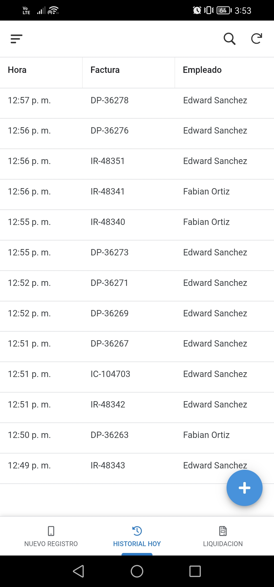
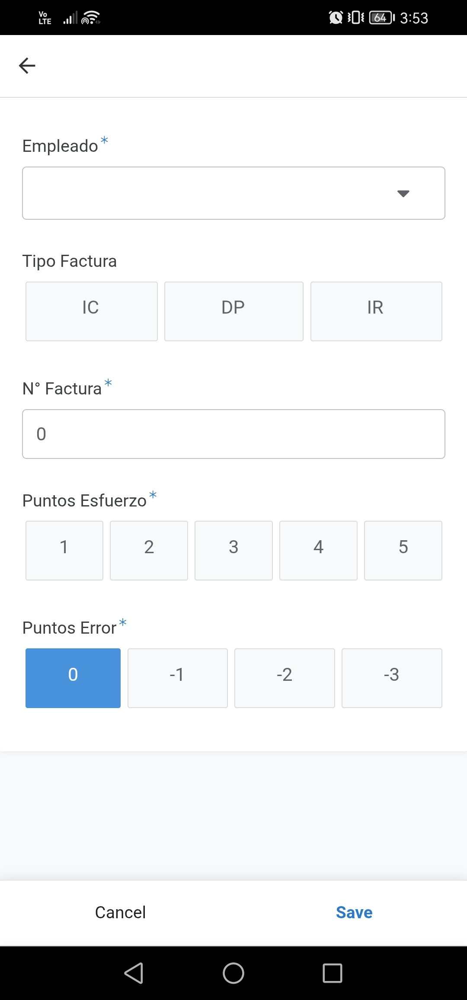
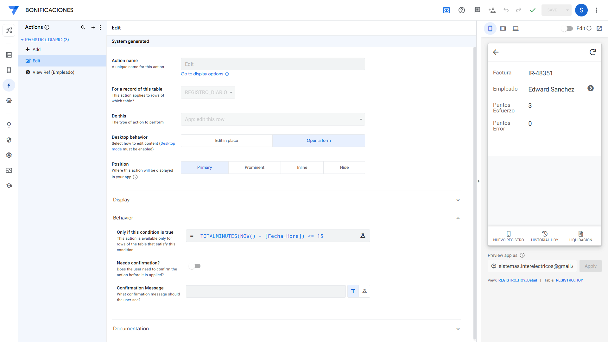
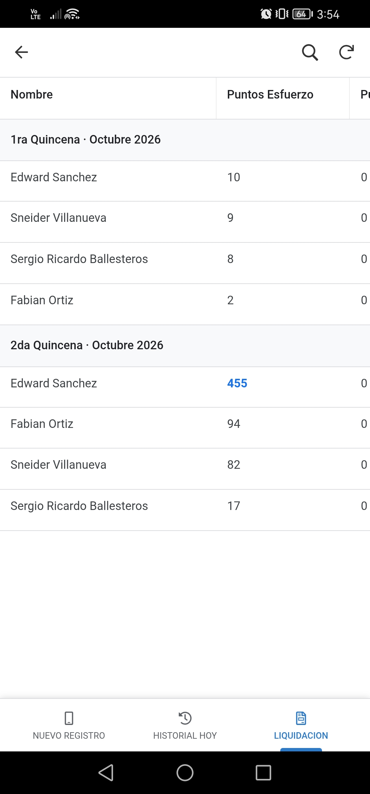
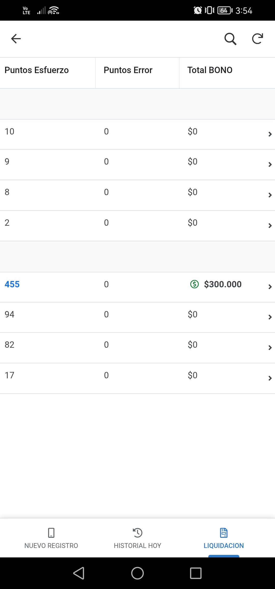
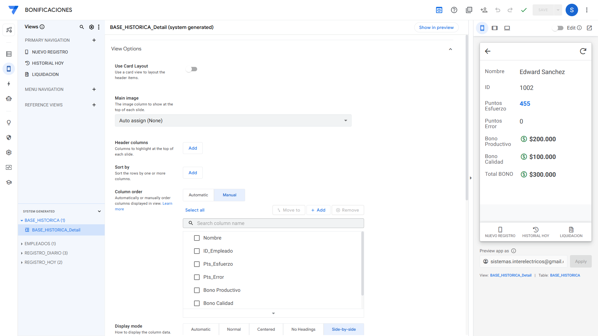

# MANUAL DE USUARIO OPERATIVO: SISTEMA BONIFICACIONES (APP MÓVIL)

<!-- ================================================================= -->
<!-- [INICIO - NO COPIAR AL PDF: INSTRUCCIÓN DE PORTADA Y SALTO DE HOJA] -->
<!-- En el PDF, la PORTADA ocupa la PÁGINA 1 completa con:              -->
<!-- - Logo de INTERELECTRICOS GROUP SAS                                -->
<!-- - Título: MANUAL DE USUARIO OPERATIVO - SISTEMA BONIFICACIONES     -->
<!-- - Subtítulo: Módulo Móvil (AppSheet) — Versión 2.0                 -->
<!-- - Autor: Mauricio Sierra - Aprendiz ADSO SENA                      -->
<!-- - Fecha: Octubre de 2026 | Versión 2.0 (Producción Optimizada)     -->
<!--                                                                    -->
<!-- PÁGINA 2: TABLA DE CONTENIDO (sola en su página).                  -->
<!-- PÁGINA 3: Inicia el contenido a partir de la Sección 1.            -->
<!-- [FIN - NO COPIAR AL PDF]                                           -->
<!-- ================================================================= -->

---

## 1. Introducción y Propósito

El aplicativo móvil **BONIFICACIONES** es la herramienta digital oficial para auditar y registrar el desempeño operativo en la zona de despachos de Intereléctricos Group SAS. Sustituye el antiguo conteo por rayas en tablero físico, garantizando que a cada colaborador se le reconozca equitativamente tanto el volumen documental procesado (complejidad de facturas) como el desgaste físico real (cortes de cable, cargue pesado, uso de maquinaria), protegiendo la calidad del despacho y garantizando total transparencia financiera.

En su **Versión 2.0**, el aplicativo incorpora un diseño enfocado en la ergonomía táctil en bodega:
* **Teclado numérico puro:** Separación del tipo de factura y el número consecutivo para digitar números a máxima velocidad.
* **Recarga continua:** El formulario queda automáticamente en blanco tras guardar para registrar múltiples alistamientos sin interrupciones.
* **Consulta histórica perpetua:** Módulo de liquidación unificado con navegación táctil por Año, Mes y Quincena, eliminando la necesidad de seleccionar fechas en calendarios.

---

## 2. Interfaz y Menú Principal de Navegación

Al ingresar a la aplicación en el dispositivo móvil o equipo de escritorio, el usuario encontrará una barra de navegación inferior permanente compuesta por **3 módulos de trabajo**:

  

<!-- ================================================================= -->
<!-- [INICIO - NO COPIAR AL PDF: GUÍA VISUAL]                           -->
<!-- En la barra inferior de '18_app_pantalla_historial.jpg', resalte   -->
<!-- los 3 iconos del menú: NUEVO REGISTRO, HISTORIAL HOY, LIQUIDACION. -->
<!-- [FIN - NO COPIAR AL PDF]                                           -->
<!-- ================================================================= -->

* **1. NUEVO REGISTRO (`first`):** Formulario de captura rápida para registrar cada factura alistada en tiempo real. Es la pantalla de inicio predeterminada al abrir la aplicación.
* **2. HISTORIAL HOY (`middle`):** Listado cronológico de las órdenes despachadas durante la jornada actual con hora exacta para verificación inmediata.
* **3. LIQUIDACION (`last`):** Tablero centralizado de consulta histórica quincenal y mensual que permite revisar el acumulado de puntos y bonificaciones ganadas por colaborador.

---

<!-- ================================================================= -->
<!-- [INICIO - NO COPIAR AL PDF: SALTO DE PÁGINA]                       -->
<!-- Se recomienda iniciar la Sección 3 en una página nueva del PDF.   -->
<!-- [FIN - NO COPIAR AL PDF]                                           -->
<!-- ================================================================= -->

## 3. Flujo Diario: Registro de un Despacho

Cada vez que un auxiliar de bodega entregue un pedido alistado junto con el comprobante físico (factura o remisión) para su revisión en mostrador, el despachador registrará la información siguiendo estos pasos secuenciales:

### 3.1. Acceso al Formulario de Captura
Al abrir el aplicativo, el sistema se posiciona automáticamente en el formulario. Si se encuentra en otra pantalla, toque el ícono **NUEVO REGISTRO** en la barra inferior:

  

<!-- ================================================================= -->
<!-- [INICIO - NO COPIAR AL PDF: GUÍA VISUAL]                           -->
<!-- En '17_app_pantalla_formulario.jpg', observe que los campos con    -->
<!-- asterisco azul (*) son de diligenciamiento obligatorio:            -->
<!-- Empleado*, N° Factura*, Puntos Esfuerzo*, Puntos Error*.          -->
<!-- [FIN - NO COPIAR AL PDF]                                           -->
<!-- ================================================================= -->

---

### 3.2. Diligenciamiento de Datos del Despacho

Complete la información del alistamiento utilizando las entradas táctiles optimizadas:

#### Paso A: Seleccionar al Empleado Responsable (`Empleado *`)
Toque la lista desplegable y elija al auxiliar que alistó la orden. El sistema muestra de forma limpia **únicamente los colaboradores activos** por su nombre completo, asociando internamente su identificador de nómina.

#### Paso B: Seleccionar el Tipo de Comprobante (`Tipo Factura`)
Toque el botón correspondiente a la serie del documento físico entregado:
* **`IC`:** Factura comercial estándar de venta.
* **`DP`:** Despacho interno o traslado de bodega.
* **`IR`:** Remisión de mercancía.

#### Paso C: Digitar el Consecutivo (`N° Factura *`)
Al tocar la casilla `N° Factura`, el celular levantará automáticamente el **teclado numérico puro con dígitos grandes**:
* Digite únicamente los números del comprobante (ejemplo: `36278` o `48351`).
* **Ventaja:** No requiere alternar entre letras y números ni teclear guiones a mano. El sistema unifica automáticamente el tipo y el número (ejemplo: `DP-36278`) como identificador oficial.

#### Paso D: Calificar Puntaje de Despacho (`Puntos Esfuerzo *`)
Presione un botón táctil del **1 al 5** evaluando de forma integral la complejidad del pedido y el esfuerzo físico invertido:
* **1 pt:** Factura simple con pocos artículos livianos, sin exigencia física extra.
* **2 a 4 pts:** Pedidos medianos con múltiples referencias o que requirieron cortes de cable conductor, mangueras, alambre o cargue de tubería pesada.
* **5 pts:** Despacho complejo con alta densidad de renglones, bobinas industriales pesadas o maniobras con montacargas.

#### Paso E: Calificar Puntos de Error (`Puntos Error *`)
Viene preseleccionado automáticamente en **0** (despacho correcto sin penalización). Solo cámbielo si detecta alguna inconformidad en el mostrador:
* **0 pts:** Despacho exacto y conforme, sin ninguna inconsistencia *(valor predeterminado)*.
* **-1 pt:** Error leve subsanable (ejemplo: omisión de un artículo menor o conteo corregido en mostrador).
* **-2 pts:** Dos errores leves detectados en la misma entrega.
* **-3 pts:** Falta crítica (ejemplo: corte erróneo de cable conductor o equivocación que cause devolución formal).

---

### 3.3. Guardar y Recarga Continua

Una vez diligenciados los campos, toque el botón azul **Save** (Guardar) ubicado en la esquina inferior derecha:

* **Transmisión Inmediata:** Los datos se sincronizan al instante en la base de datos corporativa en la nube.
* **Recarga Continua (`Auto re-open`):** Gracias a la configuración operativa V2.0, al guardar el despacho el formulario **permanece abierto y se limpia automáticamente en blanco**, listo para capturar el siguiente comprobante sin clics innecesarios.

---

<!-- ================================================================= -->
<!-- [INICIO - NO COPIAR AL PDF: SALTO DE PÁGINA]                       -->
<!-- Se recomienda iniciar la Sección 4 en una página nueva del PDF.   -->
<!-- [FIN - NO COPIAR AL PDF]                                           -->
<!-- ================================================================= -->

## 4. Historial del Turno y Auditoría Diaria

Para auditar o verificar los despachos ingresados durante la jornada de trabajo, el equipo cuenta con el módulo **HISTORIAL HOY**:

### 4.1. Acceso a la Pestaña Historial
En la barra inferior de navegación, toque el ícono **HISTORIAL HOY** (icono de reloj):

  

---

### 4.2. Navegación en la Tabla de Despachos del Día
La aplicación despliega la lista cronológica ordenada de forma descendente (los despachos más recientes arriba):

* **Columna `Hora`:** Registra la hora exacta en formato 12 horas con minutos (ejemplo: `12:57 p. m.`).
* **Columna `Factura`:** Muestra la identificación completa del comprobante (ejemplo: `DP-36278`, `IR-48351`, `IC-104703`).
* **Columna `Empleado`:** Nombre completo del auxiliar responsable del alistamiento.
* **Desplazamiento Horizontal:** Deslice el dedo hacia la derecha en la tabla para auditar los `Puntos Esfuerzo` y `Puntos Error` asignados a cada registro.

---

### 4.3. Detalle Individual de la Transacción
Al tocar sobre cualquier fila dentro de `HISTORIAL HOY`, se abre la vista de detalle con la información completa de la entrega (`Detalle del Despacho`):
* Fecha y hora exacta con timestamp.
* Comprobante unificado.
* Empleado asignado.
* Calificación de esfuerzo y penalizaciones.

---

<!-- ================================================================= -->
<!-- [INICIO - NO COPIAR AL PDF: SALTO DE PÁGINA]                       -->
<!-- Se recomienda iniciar la Sección 5 en una página nueva del PDF.   -->
<!-- [FIN - NO COPIAR AL PDF]                                           -->
<!-- ================================================================= -->

## 5. Regla de Seguridad y Auditoría: Ventana de Edición de 15 Minutos

El sistema cuenta con una política de seguridad estricta para resolver errores de digitación en bodega sin alterar la trazabilidad del proceso:

  

### Protocolo Operativo:
1. **Ventana de Autocorrección (≤ 15 minutos):**  
   Si el despachador detecta que ingresó un número de factura equivocado o seleccionó un colaborador por error, abre el registro desde **HISTORIAL HOY**, toca el botón flotante de **edición (lápiz)** en la esquina inferior derecha, corrige el campo y presiona **Save**.
2. **Cierre de Ventana (> 15 minutos):**  
   Transcurridos 15 minutos exactos desde la creación del registro, el botón de edición se oculta automáticamente. El registro queda congelado para auditoría en modo de solo lectura. Para ajustes extemporáneos, se debe remitir la solicitud al Administrador con el soporte físico de la factura.
3. **Inhabilitación de Eliminaciones (Deletes):**  
   Ningún usuario operativo cuenta con permisos para eliminar registros, garantizando la conservación histórica íntegra de la base de datos.

---

<!-- ================================================================= -->
<!-- [INICIO - NO COPIAR AL PDF: SALTO DE PÁGINA]                       -->
<!-- Se recomienda iniciar la Sección 6 en una página nueva del PDF.   -->
<!-- [FIN - NO COPIAR AL PDF]                                           -->
<!-- ================================================================= -->

## 6. Consulta de Bonificaciones y Liquidación Quincenal

Para conocer el acumulado de puntos y la compensación económica generada, ingrese al módulo **LIQUIDACION**:

### 6.1. Acceso a la Pestaña Liquidación
En la barra inferior de navegación, toque el ícono **LIQUIDACION** (icono de comprobante `file-invoice`):

---

### 6.2. Navegación Jerárquica Táctil (Drill-Down)
En dispositivos móviles, la vista de liquidación no sobrecarga la pantalla con información excesiva. En su lugar, guía al usuario a través de una navegación jerárquica fluida:

| Paso 1: Selección de Año | Paso 2: Selección de Mes |
| :---: | :---: |
| Toque el año a consultar (ejemplo: `2026 >`). |  Toque el mes deseado (ejemplo: `Octubre >`). |

---

### 6.3. Tabla Quincenal Consolidada de Desempeño
Al ingresar al mes, la aplicación despliega la tabla consolidada dividida automáticamente en **1ra Quincena** (días 1 al 15) y **2da Quincena** (días 16 al fin de mes):

| Vista 1: Nombres y Puntos de Esfuerzo | Vista 2: Penalizaciones y Total BONO |
| :---: | :---: |
|  |  |

<!-- ================================================================= -->
<!-- [INICIO - NO COPIAR AL PDF: GUÍA VISUAL - RESALTAR ELEMENTOS]     -->
<!-- En '20_app_pantalla_liquidacion_tabla_01.jpg' y '02.jpg':          -->
<!-- 1. Destaque el orden descendente por puntos de esfuerzo.          -->
<!-- 2. Resalte en AZUL los colaboradores que superaron la meta base   -->
<!--    (ejemplo: Edward Sanchez con 455 pts).                         -->
<!-- 3. Resalte en VERDE con icono 'usd-circle' el bono ganado         -->
<!--    (ejemplo: $300.000). Quienes tienen $0 no muestran icono.      -->
<!-- [FIN - NO COPIAR AL PDF]                                           -->
<!-- ================================================================= -->

#### Características Operativas de la Tabla:
* **Orden por Desempeño:** Los colaboradores aparecen ordenados de mayor a menor esfuerzo (`Pts_Esfuerzo Descending`). Los auxiliares más productivos de la quincena figuran en los primeros renglones.
* **Lupa de Búsqueda:** En la esquina superior derecha, la lupa permite buscar instantáneamente a cualquier colaborador por su nombre.
* **Reglas de Formato Visual:**
  * **AZUL:** Destaca a los colaboradores que alcanzaron o superaron la meta base quincenal (300 puntos).
  * **ROJO:** Alerta sobre penalizaciones registradas por errores en despacho.
  * **VERDE con ícono `usd-circle`:** Resalta el **Total BONO** generado cuando supera `$0`. Los colaboradores que no alcanzaron bono muestran `$0` limpio sin recarga visual.

---

### 6.4. Desglose Financiero Individual del Colaborador
Al presionar sobre el nombre de cualquier trabajador dentro de la tabla de liquidación, se despliega su ficha analítica en formato de dos columnas (*Side-by-side*):

  

<!-- ================================================================= -->
<!-- [INICIO - NO COPIAR AL PDF: GUÍA VISUAL]                           -->
<!-- En '13_view_base_historica_detail_01.png', observe que el título   -->
<!-- de la pantalla muestra la quincena consultada en la barra superior -->
<!-- (ejemplo: '1ra Quincena · Octubre 2026').                          -->
<!-- [FIN - NO COPIAR AL PDF]                                           -->
<!-- ================================================================= -->

#### Rubros del Desglose:
* **Nombre / ID:** Nombre completo y código identificador del trabajador.
* **Puntos Esfuerzo:** Sumatoria total de puntos acumulados en la quincena.
* **Puntos Error:** Conteo consolidado de penalizaciones en el ciclo.
* **Bono Productivo:** Retribución monetaria escalonada por superar la meta base (300 puntos).
* **Bono Calidad:** Fondo de calidad quincenal condicionado al cumplimiento de la meta base y descontado por cada error auditado.
* **Total BONO:** Valor total a pagar en nómina al colaborador (`Bono Productivo + Bono Calidad`).

---

<!-- ================================================================= -->
<!-- [INICIO - NO COPIAR AL PDF: SALTO DE PÁGINA]                       -->
<!-- Se recomienda ubicar la Sección 7 en la página final del PDF.      -->
<!-- [FIN - NO COPIAR AL PDF]                                           -->
<!-- ================================================================= -->

## 7. Guía Rápida de Parámetros Económicos y Calibración

Para resolver dudas e inquietudes operativas a los auxiliares de bodega, el esquema de incentivos opera bajo las siguientes reglas institucionales:

| Parámetro Operativo | Valor / Condición | Regla de Aplicación en Bodega |
| :--- | :---: | :--- |
| **Meta Base Quincenal** | **300 puntos** | Nivel de rendimiento estándar cubierto por el salario ordinario. A partir de 301 puntos se desbloquean los bonos. |
| **Tramo 1 de Productividad** | 301 a 350 puntos | Bonificación quincenal de reconocimiento inicial por sobre-esfuerzo. |
| **Tramo 2 de Productividad** | 351 a 400 puntos | Bonificación quincenal por rendimiento medio-alto sostenido. |
| **Tramo 3 de Productividad** | 401 a 450 puntos | Bonificación quincenal por alto rendimiento operativo. |
| **Tramo 4 de Productividad** | 451 o más puntos | Bonificación máxima por sobre-esfuerzo destacado. |
| **Fondo Base de Calidad** | Quincenal | Reconocimiento a la exactitud y cuidado en el despacho. **Requisito obligatorio:** Solo se otorga si el auxiliar alcanza o supera la Meta Base (300 puntos). Si no alcanza la meta, se liquida en **$0**. |
| **Penalización por Error** | Por cada falta auditada | Se descuenta directamente del Fondo de Calidad según los errores registrados en el ciclo. |
| **Protección Salarial (Piso $0)** | **$0 mínimo** | Las penalizaciones nunca generan saldo en contra ni se descuentan del salario ordinario ni de los bonos de productividad ganados. |
