# MANUAL DE USUARIO OPERATIVO: SISTEMA BONIFICACIONES (APP MÓVIL)

---

## 1. Introducción, Alcance y Propósito del Sistema

El aplicativo móvil **BONIFICACIONES** es la herramienta digital oficial de **Intereléctricos Group SAS** diseñada para estandarizar, registrar y auditar en tiempo real el desempeño operativo en la zona de despachos y alistamiento de bodega. Sustituye integralmente el antiguo conteo por rayas en tableros físicos, garantizando que a cada colaborador se le reconozca equitativamente tanto el **volumen documental procesado** (complejidad y densidad de líneas por comprobante) como el **desgaste físico real** (cortes de cable conductor, cargue de tubería pesada, manipulación de bobinas y uso de estibadores o maquinaria), blindando la exactitud del despacho y garantizando total transparencia financiera.

En su **Versión 2.0**, el aplicativo incorpora una arquitectura orientada a la ergonomía táctil en bodega y la agilidad de digitación:
* **Botonera de tipos y teclado numérico puro:** Separación física del tipo de comprobante (**IC**, **DP**, **IR**) y el número consecutivo, forzando la apertura inmediata del teclado numérico grande de Android para digitar sin alternar entre modos de letras y números.
* **Flujo de recarga continua:** El formulario se limpia automáticamente tras guardar cada comprobante y permanece en pantalla (apertura continua automática), eliminando pulsaciones innecesarias durante los picos de trabajo en mostrador.
* **Navegación jerárquica táctil:** Módulo de liquidación unificado que permite consultar el desempeño por Año, Mes y Quincena mediante toques sucesivos en pantalla, suprimiendo selectores de calendario lentos o propensos a error.
* **Auditoría de 15 minutos y congelamiento:** Ventana de autocorrección estricta de 15 minutos por registro y bloqueo total de eliminación de datos para proteger la integridad histórica de la información.

---

## 2. Interfaz y Menú Principal de Navegación

El aplicativo funciona como una aplicación web progresiva (PWA) de alto rendimiento, optimizada para terminales móviles Android de bodega y navegadores de escritorio en el mostrador.

### 2.1. Barra Superior: Estado de Sincronización y Menú del Sistema

En la parte superior de la pantalla se ubica la barra de herramientas del sistema:

* **Menú Lateral:** Ubicado en la esquina superior izquierda (tres líneas horizontales). Despliega el panel de opciones corporativas, datos del usuario activo y versión.
* **Botón de Sincronización Manual:** Ubicado en la esquina superior derecha (flechas circulares). Permite forzar una actualización inmediata con la base de datos central en Google Sheets. Si no hay conexión a internet, el aplicativo continúa operando en modo sin conexión (offline) y almacena los despachos localmente hasta recuperar la señal.

Al pulsar el botón del menú lateral, se despliega el panel corporativo:

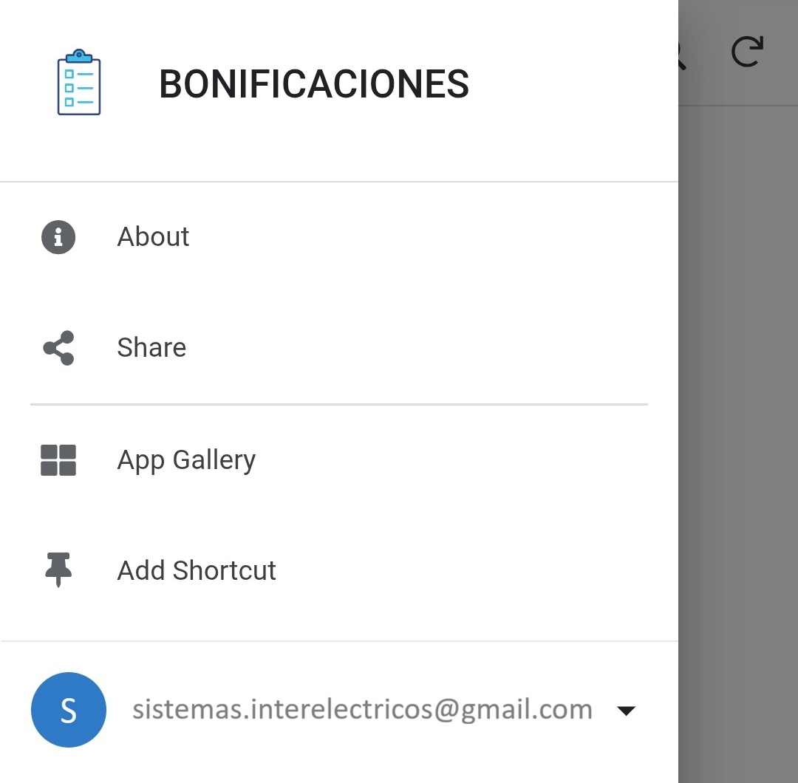

* **Identidad de la Aplicación:** Encabezado institucional con el título oficial **BONIFICACIONES**.
* **Opciones del Menú:**
  * **About:** Información técnica de la aplicación, licencia y términos.
  * **Share:** Enlace directo para compartir el acceso al aplicativo.
  * **App Gallery:** Acceso al catálogo de soluciones internas de la organización.
  * **Add Shortcut:** Permite anclar el acceso directo de la aplicación en la pantalla principal del celular.
* **Pie del Menú:** Muestra el avatar corporativo y la cuenta de correo oficial asignada al sistema (sistemas.interelectricos@gmail.com).

---

### 2.2. Barra Inferior Permanente: Los Tres Módulos de Trabajo

En la parte inferior de la pantalla se ubica la barra fija de navegación con los **tres módulos de trabajo**:

* **1. NUEVO REGISTRO:** Formulario de captura rápida para asentar cada alistamiento entregado en tiempo real. Es la vista de inicio predeterminada al abrir o desbloquear el dispositivo.
* **2. HISTORIAL HOY:** Listado cronológico de todas las órdenes despachadas durante la fecha en curso, con hora exacta y códigos unificados para verificación inmediata en mostrador.
* **3. LIQUIDACION:** Centro de consulta financiera quincenal y mensual que consolida los puntos acumulados, penalizaciones y bonos en pesos de cada colaborador.

---

## 3. Módulo 1: Nuevo Registro (Captura Operativa Continua)

El registro de alistamientos debe efectuarse en el instante exacto en que el auxiliar de bodega entrega el pedido físico en mostrador junto con el comprobante correspondiente.

### 3.1. Acceso al Formulario de Captura

Al iniciar la aplicación, el sistema se posiciona automáticamente en el formulario. Si se encuentra en otro módulo, pulse la opción **NUEVO REGISTRO** en la barra inferior:

El formulario en blanco se presenta con una interfaz optimizada para captura vertical rápida:

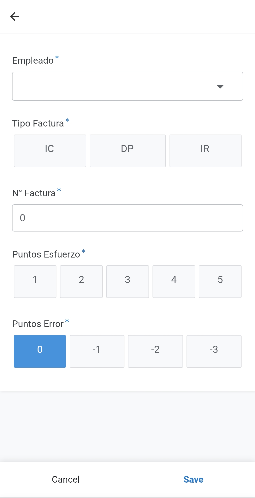

> **Nota Técnica de Diseño:**  
> Los campos de fecha y hora no se muestran en pantalla para evitar saturación visual y prevenir alteraciones manuales. El sistema captura internamente la fecha del día y la hora exacta del despacho en segundo plano al momento de guardar.

---

### 3.2. Diligenciamiento Paso a Paso de los Campos

El formulario contiene exactamente **cinco campos de entrada**, todos de diligenciamiento obligatorio:

#### Paso 1: Selección del Auxiliar Responsable (Campo Empleado)
Toque el campo desplegable para elegir al colaborador que realizó físicamente el alistamiento del pedido:

| Campo Empleado Vacío | Lista Desplegable Abierta |
| :---: | :---: |
| 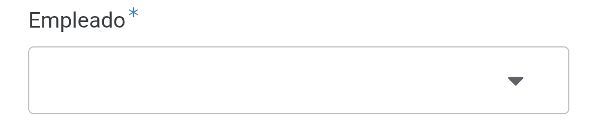 | 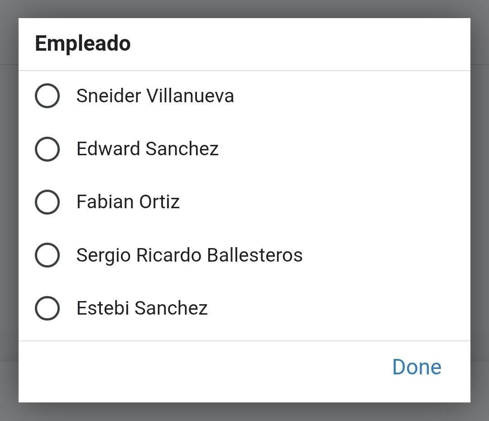 |

* **Filtro de Seguridad:** La lista muestra **únicamente los colaboradores activos** en nómina, ordenados alfabéticamente por su nombre completo (Edward Sanchez, Fabian Ortiz, Sergio Ricardo Ballesteros, Sneider Villanueva, etc.).
* **Vinculación Interna:** Al seleccionar el nombre, el sistema enlaza en segundo plano su código de nómina oficial, asegurando que los puntos se acumulen en su cuenta personal.

#### Paso 2: Selección del Tipo de Comprobante (Campo Tipo Factura)
Toque el botón correspondiente a la serie documental del comprobante físico entregado:

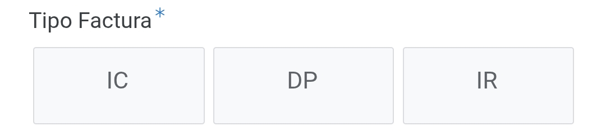

* **IC:** Factura comercial de venta a cliente.
* **DP:** Despacho interno o traslado entre bodegas de la empresa.
* **IR:** Remisión de mercancía pendiente de facturación formal.

#### Paso 3: Digitación del Consecutivo (Campo N° Factura) y Teclado Numérico
La casilla **N° Factura** se inicializa por defecto con el valor `0`. Al pulsar sobre ella para digitar, el teléfono despliega automáticamente el **teclado numérico nativo de Android**:

| Casilla N° Factura | Teclado Numérico Nativo Desplegado |
| :---: | :---: |
| 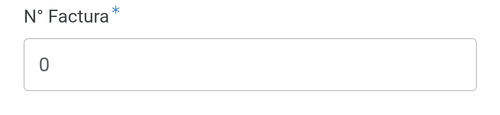 | 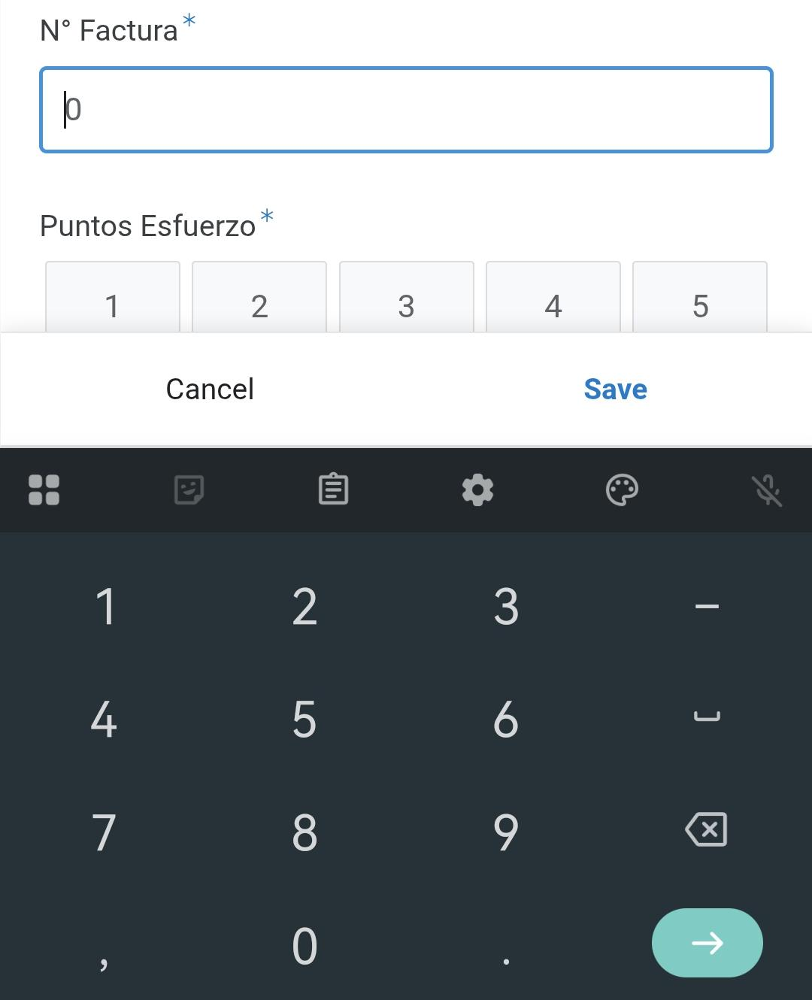 |

* **Ventaja Operativa en Bodega:** Permite digitar números a una sola mano con teclas agrandadas, sin tener que alternar entre símbolos ni teclear guiones manualmente.
* **Unificación de Código:** El sistema concatena internamente el prefijo seleccionado en el Paso 2 con el número digitado (ejemplo: si selecciona **IC** y digita `104744`, el comprobante queda registrado oficialmente como `IC-104744`).

#### Paso 4: Calificación de Dificultad y Volumen (Campo Puntos Esfuerzo)
Toque uno de los botones táctiles numerados del **1 al 5** evaluando el esfuerzo físico y la densidad del comprobante:

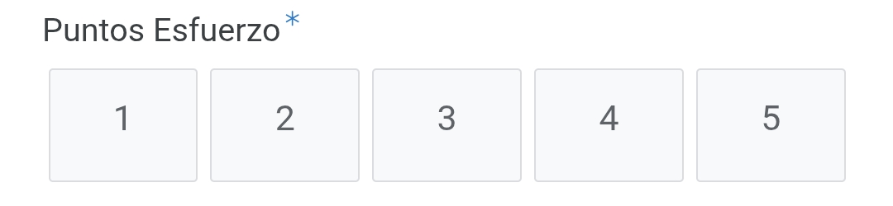

* **1 punto (Pedido Ligero / Simple):** Facturas pequeñas de 1 a 3 artículos livianos (cintas aislantes, terminales, tornillos) sin esfuerzo físico extra.
* **2 a 3 puntos (Pedido Estándar / Mediano):** Pedidos con varias líneas de producto o cajas medianas que requieran recorrido de pasillos y empaque estándar.
* **4 puntos (Pedido Pesado / Con Cortes):** Alistamientos con cortes de cable conductor en calibres medianos, manguera corrugada o cargue de rollos de alambre.
* **5 puntos (Alta Complejidad / Esfuerzo Extremo):** Pedidos con tubería pesada (conduit o PVC de diámetros mayores), corte de conductores de alta sección, bobinas industriales o maniobras con montacargas o estibadores.

#### Paso 5: Calificación de Novedades y Errores (Campo Puntos Error)
El formulario preselecciona automáticamente el botón **0** (resaltado en color azul), indicando despacho conforme:

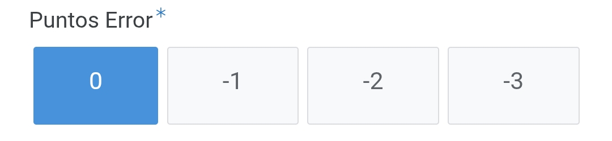

* **0 (Despacho Conforme):** Mercancía completa, referencias exactas y cantidades verificadas sin novedad (valor predeterminado).
* **-1 (Error Leve Subsanable):** Falla menor en el conteo de unidades o artículo mal ubicado que fue corregido en el mostrador sin generar reclamo.
* **-2 (Doble Falla):** Dos equivocaciones u omisiones en el mismo pedido.
* **-3 (Falla Crítica):** Corte erróneo de longitud de cable conductor, despacho de calibre equivocado o daño físico al material por mala manipulación en bodega.

---

### 3.3. Control de Validación de Errores y Guardado Continuo

Antes de almacenar la transacción, el aplicativo valida la integridad de la información:

#### Detección de Errores de Diligenciamiento
Si el despachador olvida ingresar el número consecutivo y deja el valor en `0`, o no selecciona al colaborador, el sistema bloquea el guardado y resalta la casilla en color rojo con el mensaje de advertencia institucional:

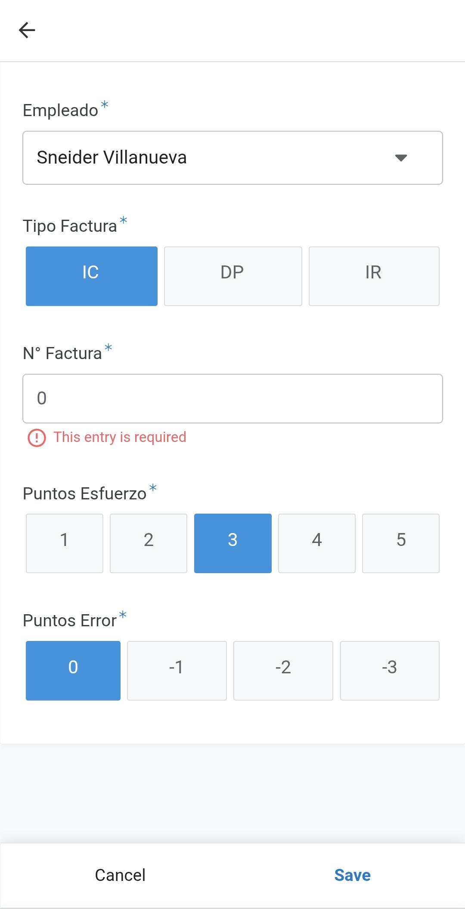

* Mensaje de validación: **This entry is required** (Esta entrada es obligatoria). El sistema no permite guardar comprobantes con número `0` ni registros sin auxiliar asignado.

#### Formulario Listo y Botón Save
Una vez completados los cinco campos obligatorios, el formulario queda listo para su procesamiento:

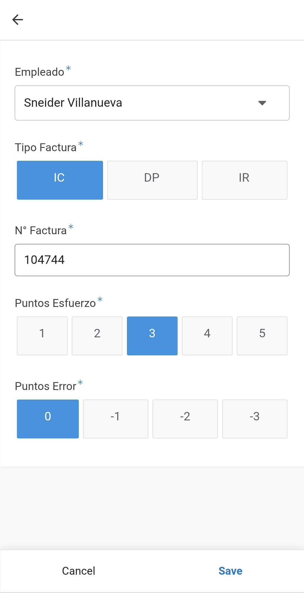

Para consolidar la orden, toque el botón **Save** (Guardar) ubicado en la esquina inferior derecha:

* **Envío Inmediato:** El registro se transmite en tiempo real a la base de datos central en la nube.
* **Recarga Continua:** El formulario **permanece en pantalla y se limpia automáticamente en blanco**, listo para capturar el siguiente comprobante de manera inmediata.

---

## 4. Módulo 2: Historial Hoy (Auditoría Diaria y Ventanas de Detalle)

El módulo **HISTORIAL HOY** es el panel de control diario para auditar el ritmo de alistamiento de la jornada, consultar comprobantes y corregir errores de captura recientes.

### 4.1. Acceso a la Lista Diaria de Despachos
En la barra inferior de navegación, pulse la opción **HISTORIAL HOY**:

A continuación, la pantalla despliega la lista cronológica de despachos registrados durante el turno:

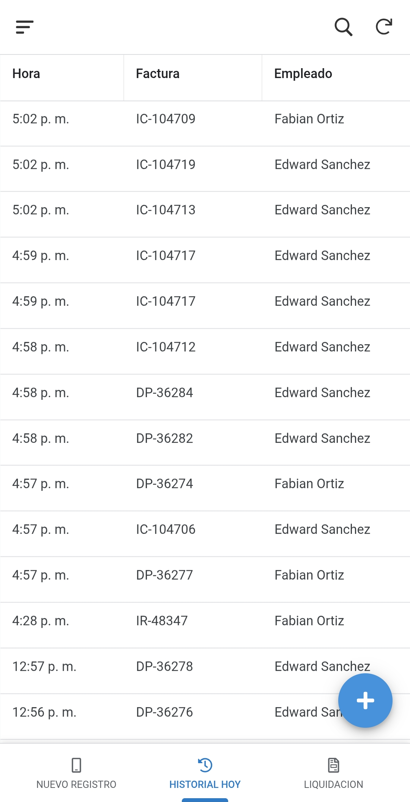

#### Elementos Visuales de la Lista:
* **Barra Superior:** Contiene el menú lateral de opciones, la herramienta de búsqueda interactiva (lupa) para filtrar facturas o empleados por texto, y el botón de sincronización manual.
* **Columnas de la Tabla:**
  * **Hora:** Hora exacta de captura del despacho (ejemplo: `6:08 p. m.`, `6:07 p. m.`, `6:06 p. m.`).
  * **Factura:** Código unificado del comprobante (ejemplo: `IC-104766`, `DP-36337`, `IR-48371`).
  * **Empleado:** Nombre completo del auxiliar responsable del alistamiento.
* **Orden Cronológico Inverso:** El comprobante más reciente siempre encabeza la lista para verificación inmediata.
* **Botón Flotante para Nuevo Registro:** El botón circular azul ubicado en la esquina inferior derecha permite abrir un nuevo formulario de captura sin salir del módulo de historial.

---

### 4.2. Ventana de Detalle del Despacho

Al pulsar sobre cualquier renglón del listado diario, la aplicación abre la ventana de detalle individual del despacho. Esta vista contiene exactamente **cuatro datos clave**:

1. **Factura:** Identificador completo del comprobante (ejemplo: `IC-104766` o `IC-104709`).
2. **Empleado:** Nombre del colaborador acompañado del icono de navegación (flecha hacia la derecha) para consultar su ficha individual.
3. **Puntos Esfuerzo:** Puntos asignados a la orden (ejemplo: `4` o `3`).
4. **Puntos Error:** Penalizaciones registradas (ejemplo: `0`).

---

### 4.3. Regla de Seguridad: Ventana de Autocorrección de 15 Minutos

Para evitar alteraciones retroactivas o modificaciones no autorizadas en bodega, el aplicativo evalúa automáticamente el tiempo transcurrido desde la creación de cada registro:

#### Caso A: Despacho Reciente (Tiempo menor o igual a 15 Minutos) — Edición Habilitada
Si el registro fue creado hace menos de 15 minutos, la ventana de detalle muestra el **botón flotante azul de edición (lápiz)** en la esquina inferior derecha y el menú de tres puntos verticales en la barra superior:

| Lista con Selección Reciente | Detalle con Botón de Edición Activo |
| :---: | :---: |
| 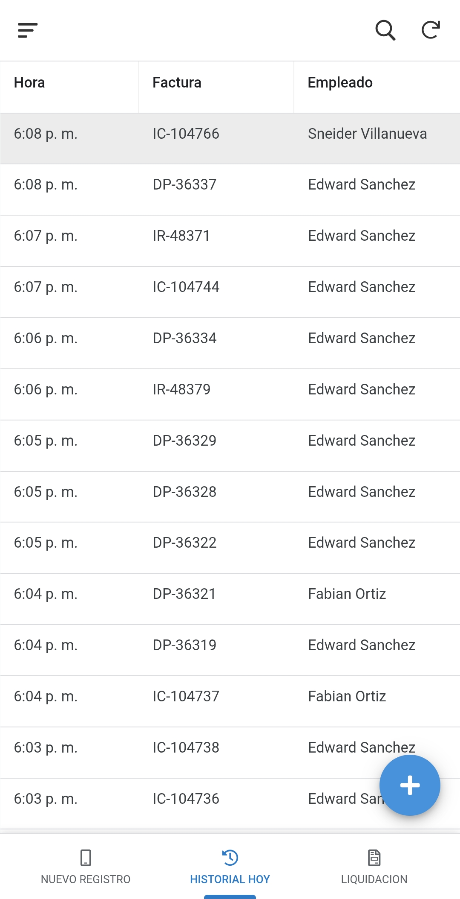 | 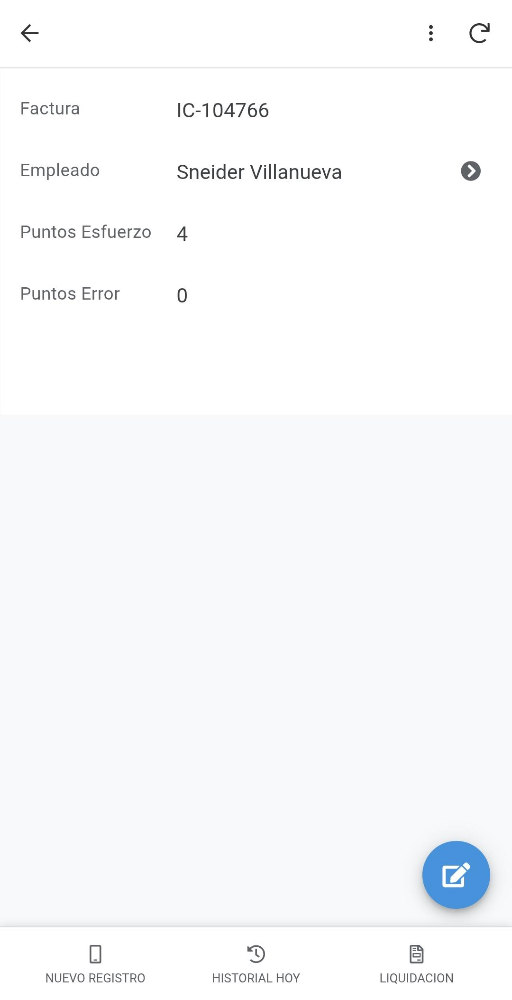 |

Al presionar el botón de edición, el sistema abre la pantalla de modificación del despacho:

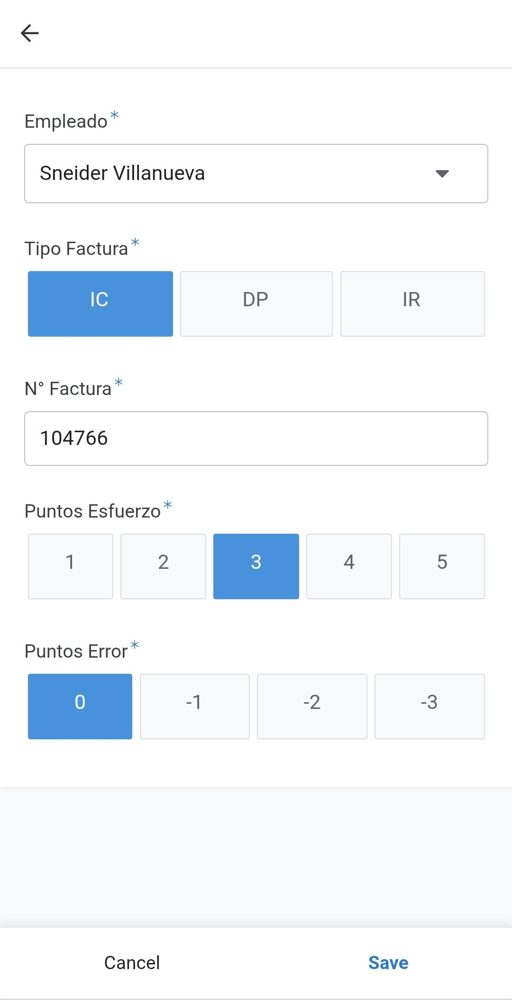

* **Modificación Permitida:** El despachador puede corregir el colaborador asignado, el tipo de factura, el número consecutivo, los puntos de esfuerzo o las penalizaciones por error.
* **Confirmación:** Toque **Save** para asentar las correcciones o **Cancel** para descartar los cambios.

---

#### Caso B: Despacho Consolidado (Tiempo superior a 15 Minutos) — Congelado para Auditoría
Transcurridos 15 minutos exactos desde la creación de la orden, el botón flotante de edición y el menú de tres puntos **se ocultan automáticamente de la interfaz**:

| Lista con Registro Antiguo | Detalle Bloqueado en Modo Solo Lectura |
| :---: | :---: |
| 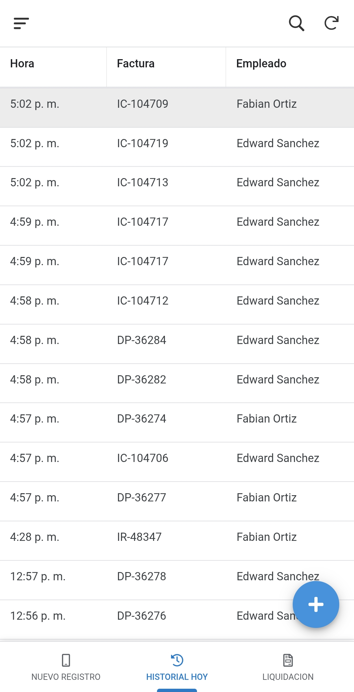 | 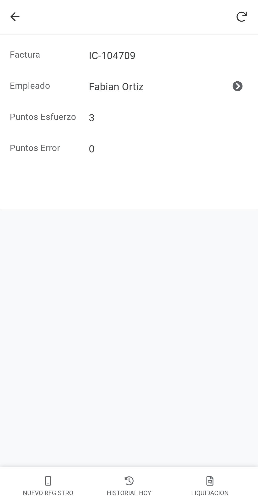 |

* **Modo Solo Lectura Permanente:** La transacción queda congelada y ya no puede ser alterada por ningún operario en bodega.
* **Protección de Datos:** La opción de eliminar registros se encuentra inhabilitada de forma definitiva en la aplicación, garantizando que el historial contable se conserve intacto.
* **Ajustes Extemporáneos:** Cualquier corrección posterior a los 15 minutos debe ser solicitada formalmente a la Jefatura de Operaciones y a la Administración del Sistema con el documento físico de soporte.

---

### 4.4. Ficha y Trazabilidad de Colaborador

Al tocar la flecha de navegación junto al nombre del empleado dentro del detalle del despacho, la aplicación abre su ficha de trazabilidad operativa:

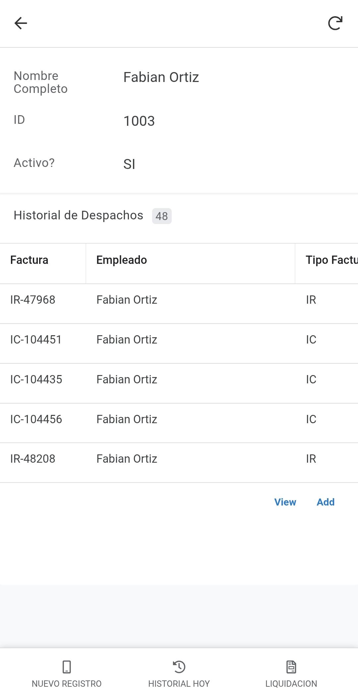

#### Atributos de la Ficha del Empleado:
* **Nombre Completo:** Nombre del colaborador (ejemplo: Fabian Ortiz).
* **ID:** Identificador numérico de nómina (ejemplo: `1003`).
* **Activo?:** Estado laboral en el maestro de personal (`SI`).
* **Historial de Despachos:** Muestra un contador gris con la cantidad acumulada de comprobantes alistados (ejemplo: `48`) y una subtabla en línea con el detalle de facturas entregadas (**Factura**, **Empleado**, **Tipo Factura**), permitiendo auditorías individuales al instante.

---

## 5. Módulo 3: Liquidación (Consulta Táctil Jerárquica y Ficha Financiera)

El módulo **LIQUIDACION** es la herramienta de consulta financiera para los colaboradores, jefes de patio y administración, donde se verifica el cumplimiento de metas y los bonos generados en pesos colombianos.

### 5.1. Acceso a la Pestaña Liquidación
En la barra inferior de navegación, toque la opción **LIQUIDACION**:

---

### 5.2. Navegación Jerárquica Táctil

Para consultar periodos anteriores sin recargar la pantalla, el sistema guía al usuario a través de dos niveles táctiles:

| Nivel 1: Selección del Año Fiscal | Nivel 2: Selección del Mes Operativo |
| :---: | :---: |
| 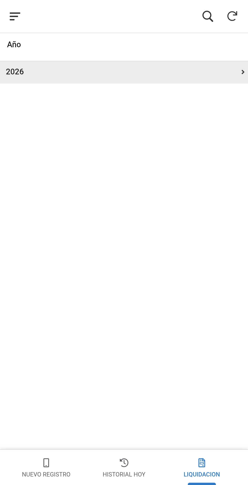 | 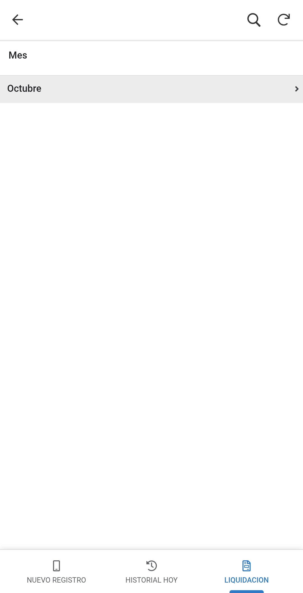 |

* **Paso 1 (Año):** Toque el año fiscal que desea revisar (ejemplo: `2026 >`).
* **Paso 2 (Mes):** Toque el mes deseado dentro de la lista (ejemplo: `Octubre >`).

---

### 5.3. Tabla Quincenal Consolidada de Desempeño

Al ingresar al mes, la aplicación presenta la matriz de liquidación agrupada automáticamente en dos bloques: **1ra Quincena · [Mes Año]** (días 1 al 15) y **2da Quincena · [Mes Año]** (días 16 al fin de mes):

| Vista 1: Nombres y Puntos de Esfuerzo | Vista 2: Penalizaciones y Total BONO |
| :---: | :---: |
| 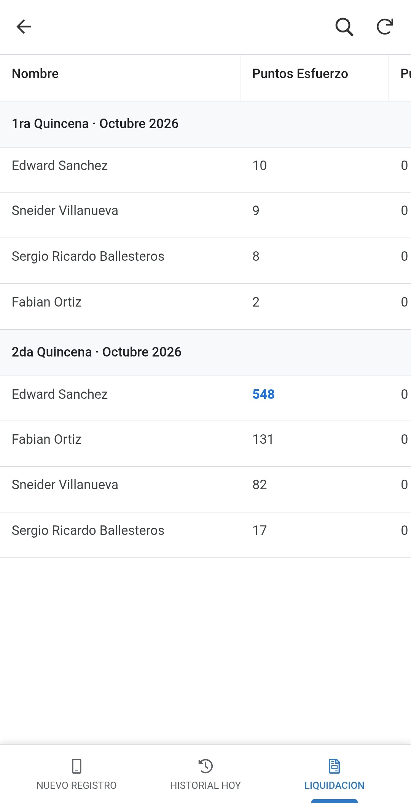 | 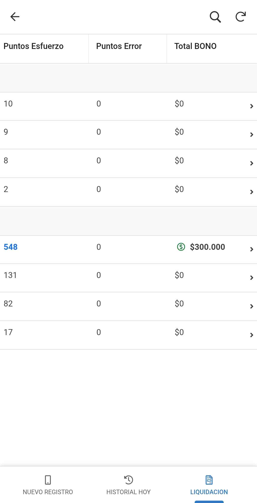 |

#### Características Técnicas de la Tabla:
* **Columnas de Desempeño:**
  * **Nombre:** Nombre completo del auxiliar de bodega.
  * **Puntos Esfuerzo:** Puntos acumulados en el ciclo. Los colaboradores que superan la meta base de 300 puntos se destacan en **color azul** (ejemplo: Edward Sanchez con `548` puntos en la 2da Quincena).
  * **Puntos Error:** Conteo de faltas y equivocaciones registradas en el periodo.
  * **Total BONO:** Retribución monetaria quincenal neta. Quienes alcanzaron bonificación se resaltan en **negrita con texto verde ($300.000)**. Quienes no alcanzaron el puntaje mínimo muestran `$0` sin recarga visual.
* **Orden por Productividad:** Dentro de cada quincena, los trabajadores se ordenan de mayor a menor puntaje de esfuerzo.
* **Herramienta de Búsqueda:** En la esquina superior derecha, la lupa permite buscar directamente a cualquier colaborador por su nombre.
* **Acceso a Detalle:** Al final de cada fila se encuentra una flecha de navegación para ingresar a la ficha analítica individual.

---

### 5.4. Ficha Analítica de Liquidación Individual

Al pulsar sobre la fila de un colaborador en la tabla quincenal, la aplicación abre su **ficha analítica individual**:

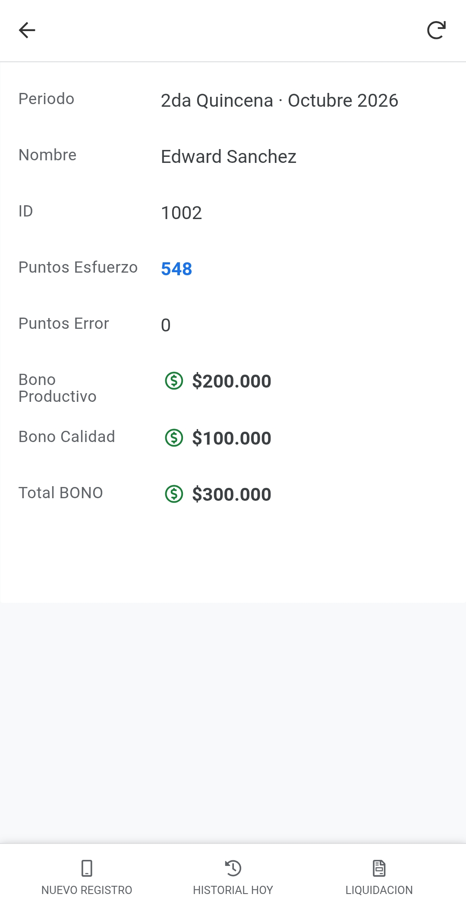

La pantalla desglosa con exactitud los **ocho rubros contables de la liquidación**:

1. **Periodo:** Quincena, mes y año fiscal evaluado (ejemplo: `2da Quincena · Octubre 2026`).
2. **Nombre:** Nombre completo del auxiliar de bodega (ejemplo: `Edward Sanchez`).
3. **ID:** Identificador de nómina del colaborador (ejemplo: `1002`).
4. **Puntos Esfuerzo:** Puntos totales de dificultad acumulados por los despachos alistados (ejemplo: `548`, destacado en color azul por superar la meta base).
5. **Puntos Error:** Faltas acumuladas en el ciclo (ejemplo: `0`).
6. **Bono Productivo:** Compensación económica por el tramo de productividad alcanzado (ejemplo: `$200.000`, resaltado en verde).
7. **Bono Calidad:** Fondo de calidad quincenal reconocido (ejemplo: `$100.000`, resaltado en verde).
8. **Total BONO:** Suma neta final a cancelar en nómina (Bono Productivo más Bono Calidad) (ejemplo: `$300.000`, resaltado en verde).

---

## 6. Matriz de Parámetros Económicos y Calibración Financiera

Para resolver dudas operativas a los auxiliares de bodega, el esquema de incentivos se rige bajo los siguientes parámetros aprobados por la Dirección de Operaciones:

| Parámetro Operativo | Valor / Condición | Regla de Aplicación en Bodega |
| :--- | :---: | :--- |
| **Meta Base Quincenal** | **300 puntos** | Nivel de rendimiento estándar cubierto por el salario ordinario. A partir de 301 puntos se desbloquea el derecho a bonificación. |
| **Tramo 1 de Productividad** | 301 a 350 puntos | Bonificación quincenal de reconocimiento inicial por sobre-esfuerzo operativo. |
| **Tramo 2 de Productividad** | 351 a 400 puntos | Bonificación quincenal intermedia por alto rendimiento sostenido. |
| **Tramo 3 de Productividad** | 401 a 450 puntos | Bonificación quincenal destacada por sobre-esfuerzo sobresaliente. |
| **Tramo 4 de Productividad** | 451 o más puntos | Bonificación máxima quincenal por productividad excepcional en bodega. |
| **Fondo Base de Calidad** | Quincenal fijo | Reconocimiento a la exactitud en el alistamiento. **Condición obligatoria:** Solo se liquida si el colaborador alcanza la meta base (300 puntos). Si no alcanza la meta, se liquida automáticamente en **$0**. |
| **Castigo por Error** | Por cada falta auditada | Se deduce directamente del Fondo de Calidad según el número de errores registrados en el ciclo quincenal. |
| **Protección Salarial (Piso $0)** | **$0 mínimo** | Los errores y penalizaciones nunca generan saldos negativos ni se descuentan del salario base ni de los bonos de productividad ganados. |

---

## 7. Preguntas Frecuentes y Protocolos de Incidencias Operativas

### ¿Qué ocurre si la bodega pierde la conexión a Internet o WiFi?
El aplicativo continúa funcionando con total normalidad en modo sin conexión (offline). Todos los despachos registrados se almacenan en la memoria local del dispositivo móvil. En cuanto el teléfono retoma la señal, el orquestador en la nube sincroniza automáticamente las órdenes con la base de datos central sin pérdida de datos.

### ¿Qué se debe hacer si se detecta un error en un despacho después de los 15 minutos?
Por estrictas políticas de auditoría, el sistema bloquea la edición local pasados 15 minutos. El despachador debe informar a la Jefatura de Bodega o al Administrador del Sistema, adjuntando la copia física del comprobante. Únicamente el administrador tiene autorización para corregir el registro directamente en la base de datos central.

### ¿Por qué un auxiliar no aparece en la tabla quincenal o figura con Total BONO $0?
* Si un auxiliar estuvo de permiso, incapacidad o no registró despachos en la quincena, no figurará en la matriz quincenal calculada por el motor.
* Si el colaborador acumuló menos de 300 puntos de esfuerzo en la quincena, su desempeño está amparado bajo el salario ordinario y el sistema liquidará `$0` en bonos productivos y de calidad.

### ¿Dónde solicitar soporte técnico?
Para soporte de conectividad, cambio de terminales móviles, restablecimiento de accesos o dudas sobre la liquidación de puntos, comuníquese con el Departamento de Sistemas de Intereléctricos Group SAS a través del canal corporativo oficial.
