# MANUAL DE USUARIO OPERATIVO: SISTEMA BONIFICACIONES (APP MÓVIL)

<!-- ================================================================= -->
<!-- [INICIO - NO COPIAR AL PDF: INSTRUCCIÓN DE PORTADA Y SALTO DE HOJA] -->
<!-- En el PDF, la PORTADA ocupa la PÁGINA 1 completa con:              -->
<!-- - Logo de INTERELECTRICOS GROUP SAS                                -->
<!-- - Título: MANUAL DE USUARIO OPERATIVO - SISTEMA BONIFICACIONES     -->
<!-- - Subtítulo: Módulo Móvil (AppSheet)                              -->
<!-- - Autor: Mauricio Sierra - Aprendiz ADSO SENA                      -->
<!-- - Fecha: Octubre de 2026 | Versión 2.0 (Producción)                -->
<!--                                                                    -->
<!-- PÁGINA 2: TABLA DE CONTENIDO (sola en su página).                  -->
<!-- PÁGINA 3: Inicia el contenido a partir de la Sección 1.            -->
<!-- [FIN - NO COPIAR AL PDF]                                           -->
<!-- ================================================================= -->

---

## 1. Introducción y Propósito

El aplicativo móvil **BONIFICACIONES** es la herramienta digital oficial para auditar y registrar el desempeño operativo en la zona de despachos de Intereléctricos Group SAS. Sustituye el antiguo conteo por rayas en tablero físico, garantizando que a cada colaborador se le reconozca equitativamente tanto el volumen documental procesado (complejidad de facturas) como el desgaste físico real (cortes de cable, cargue pesado, uso de maquinaria), protegiendo la calidad del despacho y garantizando total transparencia financiera.

---

## 2. Interfaz y Menú Principal de Navegación

Al ingresar a la aplicación en el dispositivo móvil, el usuario encontrará una barra de navegación inferior permanente compuesta por 4 módulos de trabajo:

  

<!-- ================================================================= -->
<!-- [INICIO - NO COPIAR AL PDF: GUÍA VISUAL]                           -->
<!-- En la imagen de arriba '0_menu_app.png', resalte con recuadros o   -->
<!-- flechas los 4 iconos para que el operario los identifique:         -->
<!-- [FIN - NO COPIAR AL PDF]                                           -->
<!-- ================================================================= -->

* **1. NUEVO REGISTRO:** Formulario de captura rápida para registrar cada factura alistada en tiempo real.
* **2. HISTORIAL HOY:** Listado cronológico de las órdenes despachadas durante la jornada actual para verificación operativa.
* **3. RESUMEN:** Tablero analítico consolidado (Semanal y Mensual) de puntos y liquidación monetaria.
* **4. SELECCIONE FECHA:** Selector interactivo para auditar semanas o meses pasados.

---

<!-- ================================================================= -->
<!-- [INICIO - NO COPIAR AL PDF: SALTO DE PÁGINA]                       -->
<!-- Se recomienda iniciar la Sección 3 en una página nueva del PDF.   -->
<!-- [FIN - NO COPIAR AL PDF]                                           -->
<!-- ================================================================= -->

## 3. Flujo Diario: Registro de un Despacho

Cada vez que un auxiliar de bodega entregue un pedido alistado junto con la factura física para su revisión en mostrador, el despachador registrará la información siguiendo estos pasos secuenciales:

### 3.1. Acceso al Formulario de Captura
En la barra de navegación inferior, toque el ícono **NUEVO REGISTRO**:

  

<!-- ================================================================= -->
<!-- [INICIO - NO COPIAR AL PDF: GUÍA VISUAL]                           -->
<!-- En el recorte de la barra '0_menu_app.png', resalte con un cuadro  -->
<!-- VERDE únicamente el botón 'NUEVO REGISTRO'.                        -->
<!-- [FIN - NO COPIAR AL PDF]                                           -->
<!-- ================================================================= -->

La aplicación abrirá automáticamente la pantalla en blanco con los campos obligatorios listos para registrar:

  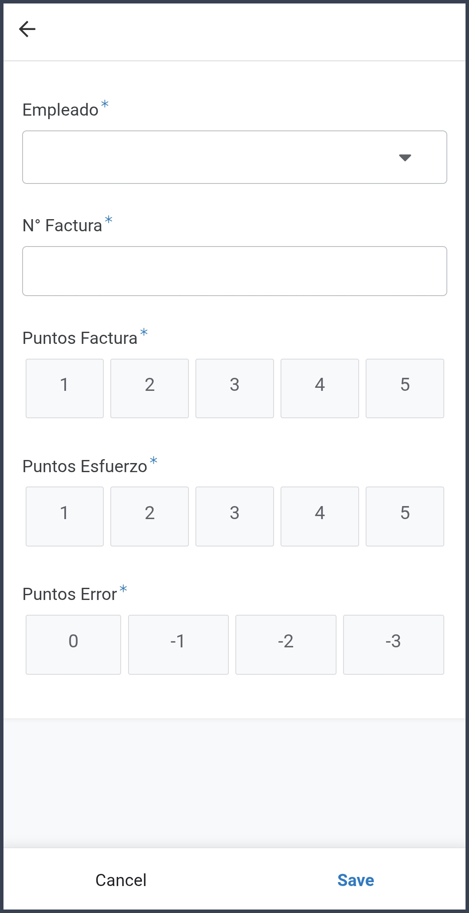

<!-- ================================================================= -->
<!-- [INICIO - NO COPIAR AL PDF: GUÍA VISUAL]                           -->
<!-- En la imagen '5_menu_nuevo_registro.png', observe que los campos   -->
<!-- tienen asterisco azul (*), lo cual indica que son obligatorios.    -->
<!-- [FIN - NO COPIAR AL PDF]                                           -->
<!-- ================================================================= -->

---

### 3.2. Diligenciamiento de Datos del Despacho

Complete la información del alistamiento utilizando las entradas táctiles optimizadas:

  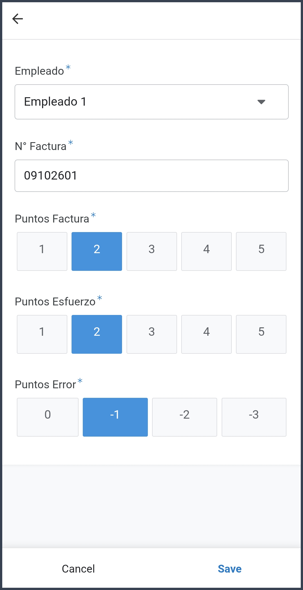

<!-- ================================================================= -->
<!-- [INICIO - NO COPIAR AL PDF: GUÍA VISUAL - RESALTAR ELEMENTOS]     -->
<!-- En la imagen '6_menu_nuevo_registro_lleno.png', marque con        -->
<!-- recuadros o flechas numeradas:                                     -->
<!-- 1. El desplegable 'Empleado *' mostrando el nombre 'Empleado 1'.   -->
<!-- 2. La casilla 'N° Factura *' con el número digitado '09102601'.    -->
<!-- 3. Los 3 botones táctiles seleccionados en color AZUL (2, 2 y -1). -->
<!-- 4. El botón 'Save' en la esquina inferior derecha.                 -->
<!-- [FIN - NO COPIAR AL PDF]                                           -->
<!-- ================================================================= -->

#### Detalle y Criterios de Calificación:

* **Paso A: Seleccionar al Empleado Responsable (`Empleado *`):**  
  Toque la lista desplegable y elija al auxiliar que alistó la orden. El sistema muestra de forma limpia únicamente los colaboradores activos por su nombre completo, asociando internamente su identificador de control.

* **Paso B: Digitar el Número de Factura (`N° Factura *`):**  
  En la casilla de texto, escriba el número consecutivo impreso en la factura o remisión física (ejemplo: `09102601`). *(Campo obligatorio para evitar registros huérfanos).*

* **Paso C: Calificar Puntos de Factura (Lectura y Densidad Documental):**  
  Presione un botón táctil del **1 al 5** evaluando la cantidad de renglones y referencias que requirió la lectura:
  * **1 pt:** Factura simple con pocos artículos o referencias estándar de fácil conteo.
  * **2 a 4 pts:** Pedidos medianos con múltiples referencias que exigieron conteo intermedio.
  * **5 pts:** Factura extensa con alta densidad de renglones que demandó lectura y revisión minuciosa.

* **Paso D: Calificar Puntos de Esfuerzo Físico (Desgaste Corporal y Logística):**  
  Presione un botón táctil del **1 al 5** según las maniobras y desgaste corporal invertido:
  * **1 pt:** Mercancía liviana ubicada en estanterías bajas, sin exigencia física extra.
  * **2 a 4 pts:** Pedidos que requirieron cortes de cable conductor, mangueras, alambre o cargue de tubería pesada.
  * **5 pts:** Maniobras complejas de carga pesada con bobinas industriales o uso del montacargas.

* **Paso E: Calificar Puntos de Error (Auditoría de Calidad en Mostrador):**  
  Inspeccione físicamente la mercancía antes de empacar y marque la casilla correspondiente:
  * **0 pts:** Despacho exacto y perfecto, sin ninguna inconsistencia.
  * **-1 pt:** Error leve subsanable (ejemplo: olvido de un ítem menor o conteo corregido en mostrador).
  * **-2 pts:** Dos errores leves detectados en la misma entrega.
  * **-3 pts:** Falta crítica (ejemplo: corte erróneo de cable conductor o equivocación que cause reclamo formal).

---

### 3.3. Guardar y Sincronizar el Registro
Una vez diligenciados los campos, toque el botón **Save** (Guardar) ubicado en la esquina inferior derecha:

<!-- ================================================================= -->
<!-- [INICIO - NO COPIAR AL PDF: GUÍA VISUAL]                           -->
<!-- Aquí puede insertar un recorte enfocado en la esquina inferior     -->
<!-- derecha donde se ubica el botón 'Save', resaltándolo con un        -->
<!-- círculo verde o rojo.                                              -->
<!-- [FIN - NO COPIAR AL PDF]                                           -->
<!-- ================================================================= -->

* **Confirmación Inmediata:** Los datos se transmiten automáticamente a la base de datos en la nube (Google Sheets).
* **Limpieza de Formulario:** La pantalla se reinicia en blanco para recibir el siguiente alistamiento sin demoras.

---

<!-- ================================================================= -->
<!-- [INICIO - NO COPIAR AL PDF: SALTO DE PÁGINA]                       -->
<!-- Se recomienda iniciar la Sección 4 en una página nueva del PDF.   -->
<!-- [FIN - NO COPIAR AL PDF]                                           -->
<!-- ================================================================= -->

## 4. Historial del Turno y Auditoría de Facturas

Para auditar o consultar los despachos ingresados durante la jornada de trabajo, el despachador cuenta con el módulo **HISTORIAL HOY**:

### 4.1. Acceso a la Pestaña Historial
En la barra inferior de navegación, toque el ícono **HISTORIAL HOY**:

  

<!-- ================================================================= -->
<!-- [INICIO - NO COPIAR AL PDF: GUÍA VISUAL]                           -->
<!-- En el recorte de la barra '0_menu_app.png', resalte con un cuadro  -->
<!-- VERDE el botón 'HISTORIAL HOY' (segundo icono con el reloj).       -->
<!-- [FIN - NO COPIAR AL PDF]                                           -->
<!-- ================================================================= -->

---

### 4.2. Navegación en la Tabla de Despachos del Día
La aplicación despliega la lista cronológica de todas las entregas registradas en la fecha actual:

| Vista Inicial: Factura y Empleado | Vista Desplazada: Puntos y Errores |
| :---: | :---: |
| 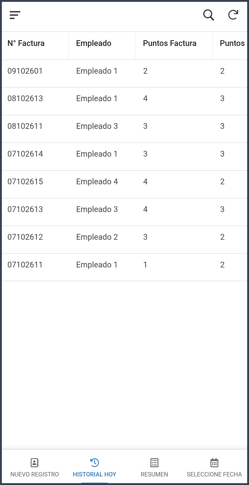 | 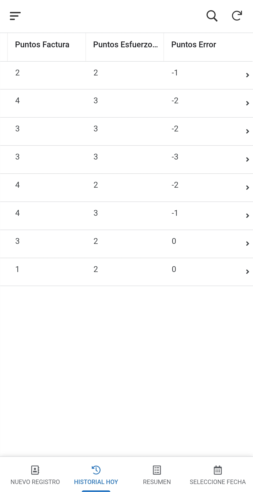 |

<!-- ================================================================= -->
<!-- [INICIO - NO COPIAR AL PDF: GUÍA VISUAL]                           -->
<!-- En '1_menu_historial_hoy_parte_1.png' señale las columnas          -->
<!-- N° Factura y Empleado.                                             -->
<!-- En '2_menu_historial_hoy_parte_2.png' coloque una flecha horizontal-->
<!-- indicando: 'Deslice con el dedo hacia la derecha para ver puntos   -->
<!-- de esfuerzo y penalizaciones de error'.                            -->
<!-- [FIN - NO COPIAR AL PDF]                                           -->
<!-- ================================================================= -->

* **Desplazamiento Táctil:** Deslice horizontalmente con el dedo sobre la pantalla para visualizar todas las columnas del registro (`N° Factura`, `Empleado`, `Puntos Factura`, `Puntos Esfuerzo` y `Puntos Error`).

---

### 4.3. Detalle Individual de la Transacción
Al tocar sobre cualquier fila de la tabla, se abre la vista de detalle con la información completa de esa entrega:

  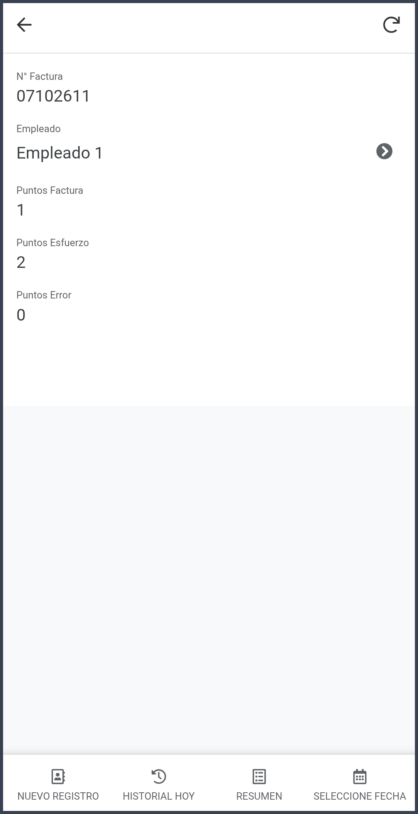

<!-- ================================================================= -->
<!-- [INICIO - NO COPIAR AL PDF: GUÍA VISUAL]                           -->
<!-- En la imagen '3_detalle_fila_tabla_historial_hoy.png', resalte con -->
<!-- un círculo rojo la flecha '>' ubicada al frente del nombre del     -->
<!-- empleado ('Empleado 1').                                           -->
<!-- Indique con texto: 'Toque la flecha > para abrir el consolidado'.  -->
<!-- [FIN - NO COPIAR AL PDF]                                           -->
<!-- ================================================================= -->

---

### 4.4. Consulta de Despachos por Empleado
Al presionar la flecha `>` junto al nombre del trabajador, la aplicación abre la ficha técnica del auxiliar:

  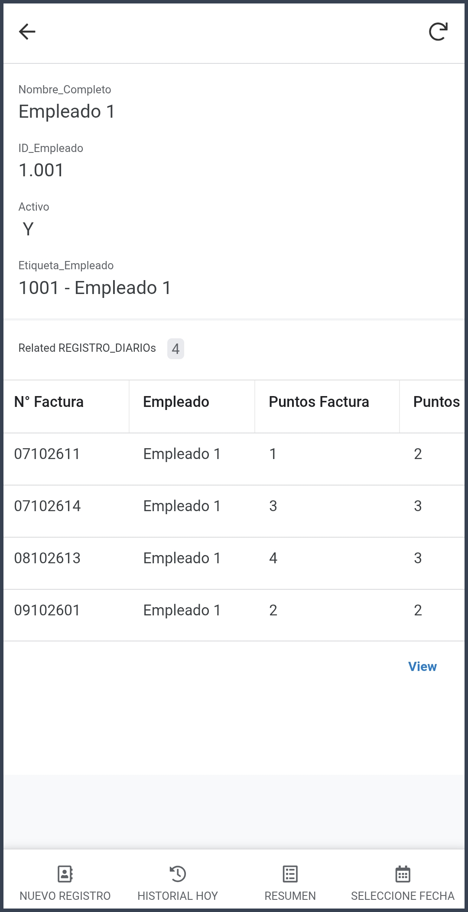

<!-- ================================================================= -->
<!-- [INICIO - NO COPIAR AL PDF: GUÍA VISUAL]                           -->
<!-- En la imagen '4_detalle_empleado_todos_registros.png', resalte:    -->
<!-- 1. El contador 'Historial de Despachos' (Related REGISTRO_DIARIOs, -->
<!--    indica cuántas facturas lleva alistadas ese trabajador en el    -->
<!--    turno).                                                         -->
<!-- 2. La tabla inferior con el listado individual de sus facturas.    -->
<!-- [FIN - NO COPIAR AL PDF]                                           -->
<!-- ================================================================= -->

* **Conteo Rápido:** La sección `Historial de Despachos` (relación del sistema `Related REGISTRO_DIARIOs`) permite al supervisor y al operario auditar exactamente cuántas órdenes ha alistado ese colaborador durante el día y revisar el detalle de cada factura.

---

<!-- ================================================================= -->
<!-- [INICIO - NO COPIAR AL PDF: SALTO DE PÁGINA]                       -->
<!-- Se recomienda iniciar la Sección 5 en una página nueva del PDF.   -->
<!-- [FIN - NO COPIAR AL PDF]                                           -->
<!-- ================================================================= -->

## 5. Regla de Seguridad y Auditoría: Ventana de Edición de 15 Minutos

El sistema cuenta con una política de seguridad estricta para resolver errores de digitación sin alterar la trazabilidad del proceso:

### Comparativa Visual: Registro Reciente vs. Registro Bloqueado

| Caso A: Dentro de los 15 Minutos (Editable) | Caso B: Superados los 15 Minutos (Bloqueado) |
| :---: | :---: |
| 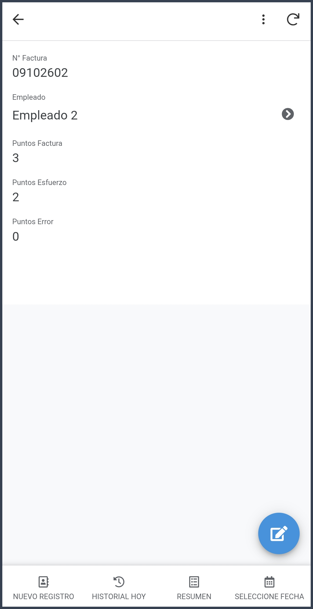 |  |
| **Aparece el botón flotante del lápiz ✏️** | **El botón del lápiz desaparece por completo** |

<!-- ================================================================= -->
<!-- [INICIO - NO COPIAR AL PDF: GUÍA VISUAL - RESALTAR ELEMENTOS]     -->
<!-- En la imagen de la izquierda (Caso A):                             -->
<!-- * Destaque con un círculo rojo llamativo el botón azul flotante con-->
<!--   icono de lápiz ✏️ en la esquina inferior derecha.                -->
<!-- * Texto guía: 'Botón habilitado para corregir datos (≤ 15 min)'.   -->
<!-- En la imagen de la derecha (Caso B):                               -->
<!-- * Señale con una X o flecha la esquina inferior derecha vacía.     -->
<!-- * Texto guía: 'Registro protegido en modo Solo Lectura (> 15 min)'.-->
<!-- [FIN - NO COPIAR AL PDF]                                           -->
<!-- ================================================================= -->

### Protocolo de Auditoría:
1. **Ventana de Autocorrección (≤ 15 minutos):**  
   Si el despachador detecta que ingresó un número de factura equivocado o seleccionó un colaborador por error, abre el registro desde **HISTORIAL HOY**, toca el botón flotante del **Lápiz ✏️**, modifica el campo y presiona **Save**.
2. **Cierre de Ventana (> 15 minutos):**  
   Transcurrido el umbral temporal, el botón de edición se oculta automáticamente y el registro queda congelado para auditoría en modo de solo lectura. Para ajustes extemporáneos, se debe remitir la solicitud a la Jefatura con el soporte físico de la factura.
3. **Inhabilitación de Eliminaciones (Deletes):**  
   Ningún usuario operativo cuenta con permisos para eliminar registros, garantizando la conservación histórica íntegra de la base de datos.

---

<!-- ================================================================= -->
<!-- [INICIO - NO COPIAR AL PDF: SALTO DE PÁGINA]                       -->
<!-- Se recomienda iniciar la Sección 6 en una página nueva del PDF.   -->
<!-- [FIN - NO COPIAR AL PDF]                                           -->
<!-- ================================================================= -->

## 6. Consulta de Resúmenes y Liquidación de Bonificaciones

Para conocer el acumulado de puntos y la compensación económica generada, ingrese al módulo **RESUMEN**:

### 6.1. Acceso a la Pestaña Resumen
En la barra inferior de navegación, toque el ícono **RESUMEN**:

  

<!-- ================================================================= -->
<!-- [INICIO - NO COPIAR AL PDF: GUÍA VISUAL]                           -->
<!-- En el recorte de la barra '0_menu_app.png', resalte con un cuadro  -->
<!-- VERDE el botón 'RESUMEN' (tercer icono).                           -->
<!-- [FIN - NO COPIAR AL PDF]                                           -->
<!-- ================================================================= -->

---

### 6.2. Visualización de Reportes Semanal y Mensual (Navegación por Pestañas)
En dispositivos móviles, el dashboard organiza los dos cortes temporales mediante **pestañas superiores táctiles** para alternar de forma inmediata sin recargar:

| Pestaña SEMANAL (Lunes a Domingo) | Pestaña MENSUAL (Mes Completo) |
| :---: | :---: |
| 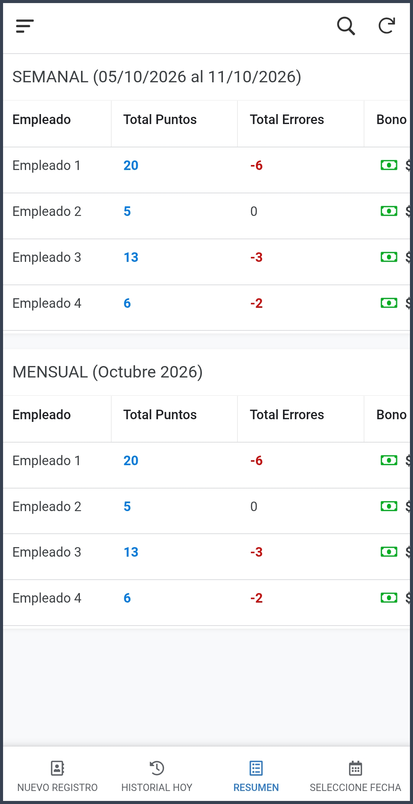 | 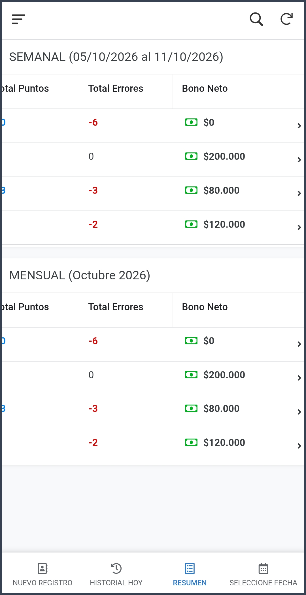 |

<!-- ================================================================= -->
<!-- [INICIO - NO COPIAR AL PDF: GUÍA VISUAL - RESALTAR ELEMENTOS]     -->
<!-- En '7_menu_resumen_parte_1.png' y '8_menu_resumen_parte_2.png':   -->
<!-- 1. Resalte con un recuadro las dos pestañas superiores de bloque: -->
<!--    * 'SEMANAL (dd/mm/aaaa al dd/mm/aaaa)': Período de lun a dom.   -->
<!--    * 'MENSUAL (Mes aaaa)': Período de mes calendario.              -->
<!-- 2. Señale el código de colores corporativos en las tablas:         -->
<!--    * AZUL: Puntos Totales ganados.                                 -->
<!--    * ROJO: Total de Errores acumulados.                            -->
<!--    * VERDE con icono de billete: Bono Neto a cobrar.               -->
<!-- [FIN - NO COPIAR AL PDF]                                           -->
<!-- ================================================================= -->

* **Pestaña SEMANAL:** Consolida los puntos acumulados de lunes a domingo de la semana consultada en `FILTRO_FECHAS`.
* **Pestaña MENSUAL:** Presenta el consolidado desde el primer hasta el último día del mes calendario en curso.
* **Navegación Táctil:** Toque directamente sobre la pestaña deseada en la parte superior de la pantalla para alternar entre el resumen semanal y mensual.

---

### 6.3. Desglose Financiero Individual y Auditoría de Facturas
Al presionar sobre la fila de cualquier trabajador en el resumen, se despliega su informe analítico individual en formato de dos columnas (*Side-by-side*):

  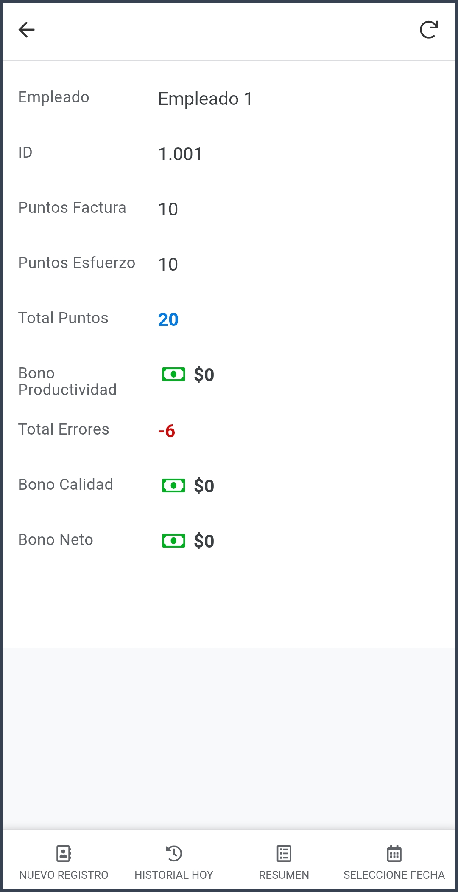

<!-- ================================================================= -->
<!-- [INICIO - NO COPIAR AL PDF: GUÍA VISUAL - RESALTAR ELEMENTOS]     -->
<!-- En '9_detalle_fila_tabla_resumen.png', destaque con un recuadro    -->
<!-- los tres renglones económicos finales:                             -->
<!-- * Bono Productividad                                              -->
<!-- * Bono Calidad                                                    -->
<!-- * Bono Neto                                                       -->
<!-- [FIN - NO COPIAR AL PDF]                                           -->
<!-- ================================================================= -->

#### Conceptos del Desglose:
* **Empleado / ID:** Nombre completo y código identificador del auxiliar.
* **Puntos Factura:** Puntos devengados exclusivamente por lectura y complejidad documental.
* **Puntos Esfuerzo:** Puntos devengados por desgaste corporal y trabajo pesado.
* **Total Puntos:** Sumatoria consolidada (`Puntos Factura + Puntos Esfuerzo`).
* **Bono Productividad:** Retribución monetaria por superar el umbral mínimo de 100 puntos semanales.
* **Total Errores:** Cantidad de penalizaciones registradas en el ciclo.
* **Bono Calidad:** Fondo de calidad restante ($200.000 garantizados menos $40.000 por cada error). **Requisito indispensable:** Solo se liquida si el colaborador alcanza o supera la meta mínima de puntos del ciclo (fijada en la celda `B2` de `CONFIGURACION`, base 100 puntos). Si no alcanza la meta mínima, se liquida en $0.
* **Bono Neto:** Importe neto total a transferir o pagar al colaborador (`Productividad + Calidad`).
* **Registros Semanales / Registros del Mes:** Lista desplegable inferior que muestra todas las facturas despachadas por ese colaborador acotadas estrictamente al ciclo seleccionado, permitiendo validar cada despacho en detalle.

---

<!-- ================================================================= -->
<!-- [INICIO - NO COPIAR AL PDF: SALTO DE PÁGINA]                       -->
<!-- Se recomienda iniciar la Sección 7 en una página nueva del PDF.   -->
<!-- [FIN - NO COPIAR AL PDF]                                           -->
<!-- ================================================================= -->

## 7. Consulta de Periodos Históricos (Módulo Seleccione Fecha)

Para auditar semanas o meses pasados sin modificar fórmulas ni fórmulas de cálculo, siga este procedimiento paso a paso:

### Paso 1: Ingresar al Módulo y Activar Edición
En la barra inferior, toque el ícono **SELECCIONE FECHA**. La pantalla mostrará la fecha de referencia activa y los rangos calculados de semana y mes:

  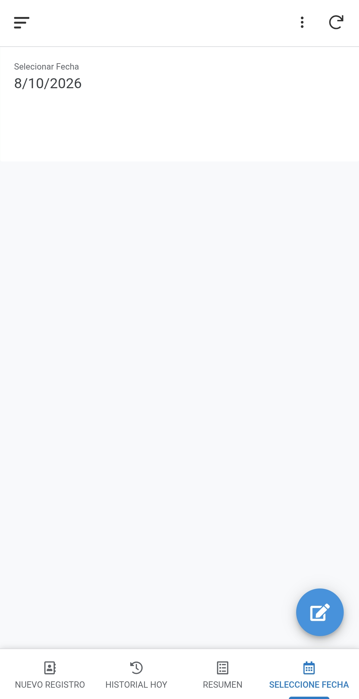

<!-- ================================================================= -->
<!-- [INICIO - NO COPIAR AL PDF: GUÍA VISUAL]                           -->
<!-- En '10_menu_selecione_fecha.png', resalte con círculo rojo el      -->
<!-- botón flotante del lápiz ✏️ en la esquina inferior derecha o la    -->
<!-- casilla de fecha directa con QuickEdit.                            -->
<!-- Texto guía: 'Toque la fecha o el lápiz para cambiar el período'.   -->
<!-- [FIN - NO COPIAR AL PDF]                                           -->
<!-- ================================================================= -->

* **Opción Rápida (Recomendada):** Gracias a la propiedad *QuickEdit*, toque directamente sobre la casilla interactiva de fecha (`Seleccionar Fecha*` o su ícono de calendario 📅) para abrir el selector en un solo toque.
* **Opción Alternativa:** Toque el **botón azul flotante del lápiz ✏️** en la esquina inferior derecha para abrir el formulario de edición.

---

### Paso 2: Abrir el Selector de Calendario
Toque directamente sobre la casilla de fecha:

  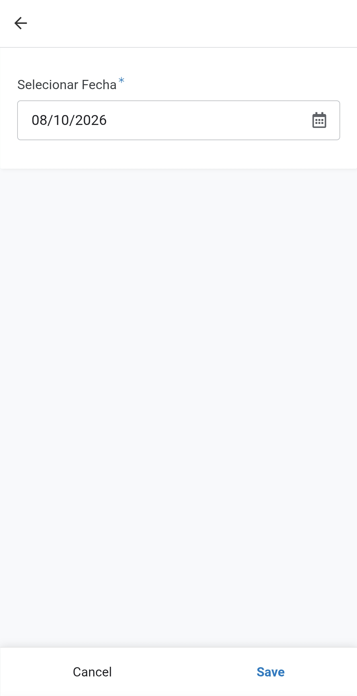

<!-- ================================================================= -->
<!-- [INICIO - NO COPIAR AL PDF: GUÍA VISUAL]                           -->
<!-- En '11_formulario_seleccione_fecha.png', señale con una flecha el  -->
<!-- campo de fecha con el icono de calendario a la derecha.            -->
<!-- [FIN - NO COPIAR AL PDF]                                           -->
<!-- ================================================================= -->

---

### Paso 3: Escoger la Fecha en el Calendario
El sistema abrirá el calendario interactivo del teléfono:

  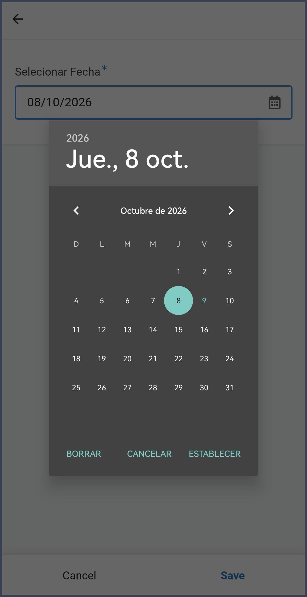

<!-- ================================================================= -->
<!-- [INICIO - NO COPIAR AL PDF: GUÍA VISUAL]                           -->
<!-- En '12_seleciona_fecha.png', resalte:                              -->
<!-- 1. El día seleccionado en el círculo verde/turquesa.              -->
<!-- 2. La opción 'ESTABLECER' en la esquina inferior derecha del modal.-->
<!-- [FIN - NO COPIAR AL PDF]                                           -->
<!-- ================================================================= -->

* Seleccione cualquier día que pertenezca a la semana o mes que desea auditar.
* Toque la opción **ESTABLECER**.

---

### Paso 4: Confirmar y Guardar el Filtro
El valor seleccionado se reflejará en la casilla:

| Guardar el Cambio | Fecha Actualizada en el Sistema |
| :---: | :---: |
| 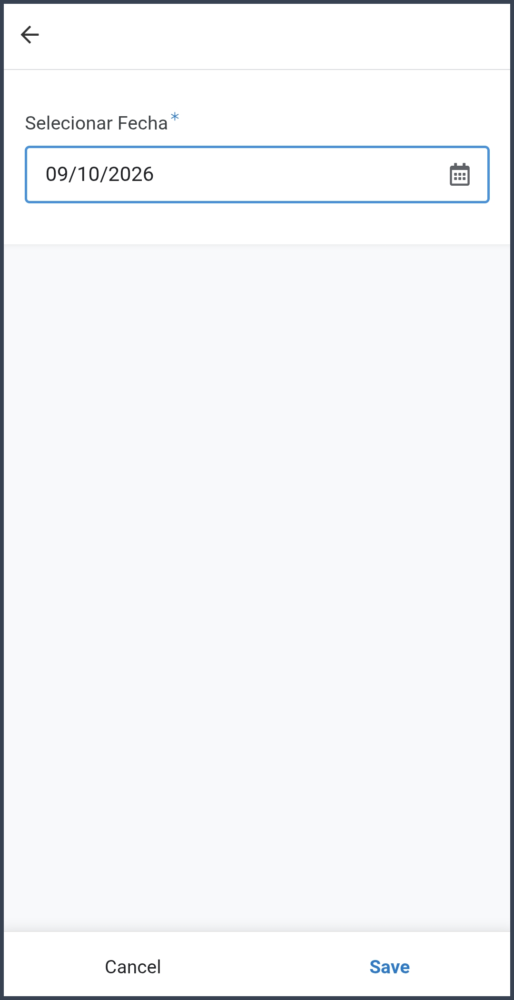 |  |

<!-- ================================================================= -->
<!-- [INICIO - NO COPIAR AL PDF: GUÍA VISUAL]                           -->
<!-- En '13_fecha_cambiada_a_guardar.png', resalte con un círculo el    -->
<!-- botón 'Save' en la esquina inferior derecha.                       -->
<!-- En '14_fecha_cambiada.png', resalte la nueva fecha activa.         -->
<!-- [FIN - NO COPIAR AL PDF]                                           -->
<!-- ================================================================= -->

* Toque el botón **Save** (Guardar).
* **Actualización en Cascada:** Al regresar a la pestaña **RESUMEN**, todas las tablas, cálculos y títulos dinámicos se habrán actualizado automáticamente para corresponder a la fecha seleccionada.

---

<!-- ================================================================= -->
<!-- [INICIO - NO COPIAR AL PDF: SALTO DE PÁGINA]                       -->
<!-- Se recomienda ubicar la Sección 8 en la página final del PDF.      -->
<!-- [FIN - NO COPIAR AL PDF]                                           -->
<!-- ================================================================= -->

## 8. Guía Rápida de Parámetros Económicos

Para resolver inquietudes operativas a los colaboradores de bodega, el esquema financiero del sistema opera bajo las siguientes reglas claras:

| Parámetro Operativo | Valor / Condición | Regla de Aplicación |
| :--- | :---: | :--- |
| **Meta Base de Productividad** | **100 puntos** | Cubierta por el salario ordinario. A partir del punto 101 se liquidan bonos escalonados. |
| **Escalón 1 de Productividad** | 101 a 120 puntos | Bonificación de **$150.000** |
| **Escalón 2 de Productividad** | 121 a 150 puntos | Bonificación de **$300.000** |
| **Escalón 3 de Productividad** | 151 a 180 puntos | Bonificación de **$450.000** |
| **Escalón 4 de Productividad** | 181 o más puntos | Bonificación de **$600.000** (Escala máxima) |
| **Fondo Base de Calidad** | **$200.000** | Monto base disponible al inicio del ciclo de medición. **Requisito indispensable:** Alcanzar la meta mínima de puntos acumulados (`CONFIGURACION!$B$2`, base 100 puntos). Si no se alcanza la meta mínima, se liquida en **$0**. |
| **Penalización por Error** | **-$40.000** por punto de error | Se descuenta directamente del fondo base de calidad según las faltas auditadas (siempre que se alcance la meta mínima de puntos). |
| **Protección Salarial (Piso $0)** | **$0 mínimo** | El bono de calidad nunca genera saldo en contra ni efectúa deducciones del sueldo ordinario. |
